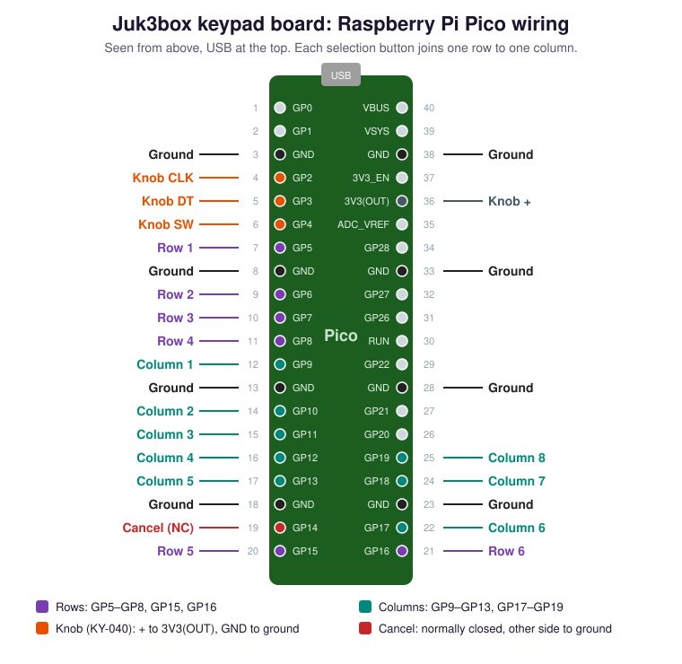

# Juk3box

A jukebox built on a Raspberry Pi: a song board on a screen, a knob and keypad, light shows that follow the music, and your music from a phone (Bluetooth or the Juk3box Helper app), a USB drive or AirPlay.

## What you need

The parts of our build, a Rock-Ola cabinet with 100 selections. Only the Pi, the card and
a screen are required: everything else is optional, and the jukebox works with what it finds.

**The computer and sound**

| Part | Notes |
|---|---|
| Raspberry Pi 5 (4 GB) | A Pi 4 works too |
| Raspberry Pi Active Cooler | A Pi 5 in a closed cabinet needs it |
| Raspberry Pi RTC Battery | Optional (Pi 5): keeps the time while it's off |
| microSD card, 16 GB or more | |
| Raspberry Pi DAC Pro | Clean sound out; found by itself. Without it, sound goes out over HDMI |
| An amplifier and speakers | Ours: a Fosi BT30D Pro (2.1, TPA3255) on its own 48 V 5 A supply |
| A screen | Any HDMI screen, behind the cabinet's glass. The song board fits itself to it |

**The controls** (wiring below)

| Part | Notes |
|---|---|
| Raspberry Pi Pico | The keypad board, plugged into the Pi by USB. The original Pico (RP2040), not the Pico 2 |
| Selection buttons | Momentary: your cabinet's own, or arcade buttons. 100 selections = 10 letters and 10 numbers (20 buttons); 160 = 20 letters and 8 numbers; Rock-Ola numbers-only = 10 digits |
| A knob | A KY-040 rotary encoder module (or a Bourns PEC11R): it turns and presses |
| A Cancel button | Normally closed. A normally open one works too, wired in the matrix like a selection button |
| A USB keyboard | Optional, for trying it out or instead of buttons: it always works |

**Lights** (optional)

| Part | Notes |
|---|---|
| SK6812 RGBW pixels | One under each button (ours: 23), data on GPIO12 |
| WS2812B strip | Accent lighting (ours: 349 pixels across the upper panel and the footlights), data on GPIO13 |
| WS2812B strips for the level bar | Ours: 36 strips of 5 (180 pixels), data on GPIO10 (SPI) |
| 2 × Adafruit Pixel Shifter (#6066) | Lift the data lines from 3.3 V to the 5 V the LEDs need |
| Our power board | Fuses each branch and carries the shifters: `docs/jukebox-power-board-revE.png` |

**Power**

| Part | Notes |
|---|---|
| Mean Well LRS-150F-5 (5 V 22 A) | For the Pi (through header pins 2 and 4) and every light. Set it to 5.2–5.25 V |
| Switched IEC inlet with a 5 A slow-blow fuse, and a small power strip | One cord and one switch for the whole cabinet |

Without lights, the official Raspberry Pi USB-C power supply is enough.

## Wire the keypad board

| What | Pico pins (physical pin) |
|---|---|
| Selection rows, up to 6 | GP5 (7), GP6 (9), GP7 (10), GP8 (11), GP15 (20), GP16 (21) |
| Selection columns, up to 8 | GP9 (12), GP10 (14), GP11 (15), GP12 (16), GP13 (17), GP17 (22), GP18 (24), GP19 (25) |
| Knob CLK, DT, SW | GP2 (4), GP3 (5), GP4 (6) |
| Knob + and GND | 3V3(OUT) (36), any GND |
| Cancel, normally closed, to ground | GP14 (19) and GND (18) |

- **Selection buttons** each join one row to one column: up to 48. Wire them in any order;
  setup learns which is which. No resistors or diodes: the Pico's own pull-ups do it.
- **The knob** runs on 3.3 V. Never 5 V: the Pico's pins aren't 5 V tolerant.
- **Old contacts** in a vintage cabinet: clean them (DeoxIT). A button that still bounces
  is caught in setup and given a longer settle time.
- Plug the Pico into one of the Pi's USB ports.

The keypad program and how it's installed: `firmware/pico-keypad/README.md`.

## Make one

You need a Raspberry Pi 5 or 4, a microSD card (16 GB or more), and a computer to write the card.

1. Install [Raspberry Pi Imager](https://www.raspberrypi.com/software/).
2. Get Juk3box into Imager, either way:
   - **From Imager's list:** open Imager's app options, set **Content repository** to
     `https://github.com/SnorbWorks/juk3-box/releases/latest/download/imager.json`, and choose **Juk3box** as the operating system.
   - **Or download** `juk3box-….img.xz` from the [newest release](https://github.com/SnorbWorks/juk3-box/releases/latest) and choose **Use custom** in Imager.
3. Write the card. Skip Imager's settings (name, Wi-Fi, users): the jukebox asks for everything itself.
4. Put the card in the Pi and start it. After a minute the screen shows **Juk3box Setup** with a Wi-Fi name and its password.
5. On your phone, open Settings › Wi-Fi and join that network; the setup page opens by itself (or open the Juk3box Helper app, tap **Set up a new jukebox** and scan the small code on the screen). The setup pages walk you through the rest: a password, a name, your Wi-Fi, the hardware checks, your music.

With a network cable plugged in, the screen shows an address to open instead of the Wi-Fi.

## Your controls

The setup step **Your controls** gets the buttons working:

1. **The keypad board.** A new Pico: hold its white BOOTSEL button while you plug it in,
   and setup installs the keypad program (about a minute). An older version of the
   program is updated in one tap.
2. **What's on your buttons.** Pick 100 (A–K and 1–0), 160 (A–V and 1–8), Rock-Ola's
   numbers (100–299), or tick your own letters and numbers. A preview of the song board
   shows its numbers: check the first and last against your cabinet's title cards.
3. **Teach each button.** The cabinet asks: turn the knob one click each way, press it,
   press Cancel, then each key. A keypad that already sends letters only needs a quick
   press of every key, in any order.
4. **Try it.** Pick a song, turn the knob, press Cancel: the screen says what it read.
   Nothing plays.

To change it later (a new keypad, a key fixed): Admin › Setup › **Teach the buttons
again**. A plugged-in keyboard always works too: letters and numbers pick, ← → and Enter
are the knob, Backspace is Cancel, ↑ ↓ are the volume.

## Updates

A jukebox checks for a new release each night and installs it (Admin › Setup › Updates, where it can also be turned off or run now). Updates are only installed if they're signed with this project's key; if a new version doesn't start properly, the jukebox goes back to the one it had.

## Last.fm

Setup asks for your own free Last.fm API key. It fills the board's Top 100 and lets the light show match each song's genre. You can skip it and add it later on the admin's Setup page.

## For developers

The jukebox is a set of small Python services talking over MQTT (`services/`), a browser-based screen (`services/jb_ui`), and an admin web app (`services/jb_admin`, port 8080). `deploy/deploy.sh <service>` sends a working copy to a Pi; `deploy/install/install.sh` installs everything on a fresh Raspberry Pi OS Lite; `deploy/image/build-image.sh` makes the card image, and `deploy/release.sh v1.2.3` publishes a release (GitHub builds it). Docs are in `docs/`.

## License

Juk3box is free software under the GPL-3.0 (`LICENSE`). In plain words: anyone may use
it, for anything, including in a jukebox they sell; study it; change it; and share it,
changed or not. Whoever shares it, or sells a jukebox with it, must pass the same
freedoms on: the source code (with their changes) under the same license, and the
license notices kept. It comes with no warranty. The license text is what counts; this
is only a summary.

It's built on other free software, each under its own license: `THIRD-PARTY.md` lists
them all (bundled fonts and icons, CircuitPython for the keypad board, the Python
packages, and the Raspberry Pi OS programs it runs on). The Neon theme's concert video
and pictures were made for this project and are covered by its license
(`themes/neon/assets/CREDITS.md`).
