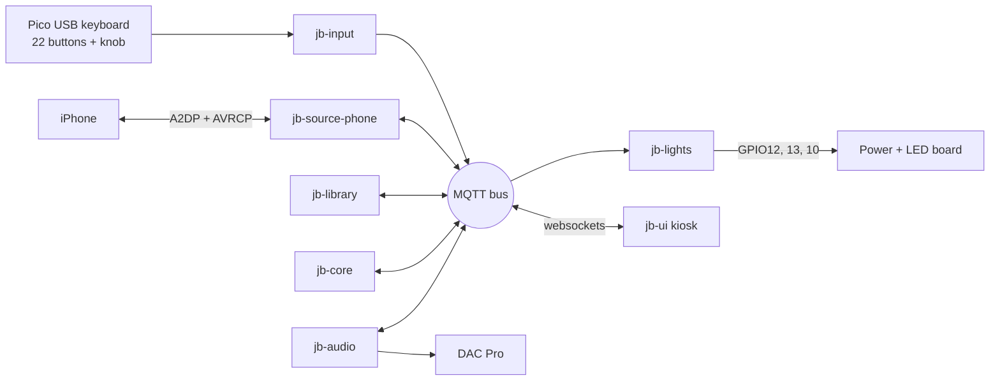

# Virtual Jukebox — Development Plan

Sep 24, 2026 · @shawn

## Architecture

The jukebox is a Bluetooth-only appliance: an iPhone pairs like it would to a car head unit, A2DP carries audio, and AVRCP handles library browsing and control. BlueZ runs Bluetooth, PipeWire routes audio to the DAC Pro, and WiFi is used only for SSH admin. AirPlay was evaluated and dropped because a receiver cannot query or select from the phone's library.

Music sources are pluggable. The phone is the first source adapter; library, core and UI talk to one source interface (browse, play item, now-playing, artwork), so Hard Drive and Spotify become new adapters, not rewrites.

Services never call each other directly, only through the bus, so each can be built and tested alone.

| Service | Owns |
| --- | --- |
| jb-input | Pico key and encoder events to logical actions; gesture engine (click, double, hold, push-and-turn) |
| jb-audio | DAC, local mixer volume, mute |
| jb-source-phone | Pairing, phone registry, connect/disconnect/switch, AVRCP browse, transport, now-playing, artwork |
| jb-library | SQLite cache per source and per phone: crawl, change detection + diff, sort views, local play counts |
| jb-core | Current page, sort mode, letter + digit entry, selection queue, menu state |
| jb-lights | Button pixels, accent strip and volume/level bar: scenes driven by jb-core state, audio level from PipeWire, per-frame current limiter |
| jb-ui | Web song board in a Chromium kiosk, subscribed to MQTT over websockets |

Stack: Pi OS Lite 64-bit, Python 3 + asyncio, dbus-next (BlueZ), evdev, aiomqtt, SQLite, PipeWire/WirePlumber, cage + Chromium, mosquitto. The Pico runs CircuitPython.

## Hardware

A single Raspberry Pi Pico, presenting as a USB keyboard, reads every control on the Rock-Ola 435 front panel: 24 of its 26 GPIO, 2 spare.

| Part | Role | Notes |
| --- | --- | --- |
| Raspberry Pi 4 | Main computer | Owned; powered through the header from the board's Pi branch |
| Raspberry Pi DAC Pro HAT | Audio out | Uses GPIO 0–3, 18–21, 27; has a 40-pin pass-through header |
| Raspberry Pi Pico | Input controller, USB keyboard HID | **Bought.** CircuitPython; reports press/release only; keyboard only, no LEDs |
| 20 selection keys | A–K (no I) and 1–0 | 10 × 10 = 100 slots per page; momentary, non-latching |
| Reset button | Momentary switch | Gesture input |
| Coin-return button | Converted to rotary encoder + push switch; volume knob | Mechanical retrofit, see Phase 2a |
| KY-040 encoders (6-pack) | Bench prototyping | **Bought.** Power from 3.3V; SW needs internal pull-up |
| Bourns PEC11R | Optional final encoder | Same pinout, drop-in upgrade |
| 24× SK6812 RGBW pixels | One under each button (+ coin-return knob optional) | BTF 10 mm boards, natural white, GRBW, 5V, 60 mA max each |
| WS2812B strip, 5 m / 300 px | Accent lighting | 5V, GRB, one chip per LED; up to 18A at full white; power injected at 5 points |
| LED board (custom PCB) | One 5V input, four fused branches, level shifting for three LED chains | Stacks on the DAC Pro; see LED and power board |
| Mean Well LRS-200-5 | 5V supply for the Pi and all LEDs, 5V 40A (200W) | Fanless; set to 5.2–5.25V; one 12 AWG pair to the board |
| Monitor | Song board display | Size and resolution TBD |
| USB Bluetooth dongle + extension | Fallback only | Only if in-cabinet range is weak |
| Volume / level bar | Volume and sound-level meter | 32 segments of 4" WS2812B (6 px each, 192 px), in a diffused aluminum channel |
| Fosi BT30D Pro | 2.1 amplifier (TPA3255) | Runs on its own 48V 5A brick inside the cabinet |
| IEC inlet + internal power strip | One cord, one switch for the whole cabinet | Switched inlet with 5A slow-blow fuse; feeds the Mean Well and the amp brick |

Pin budget: 21 switches + 3 encoder pins (A, B, SW) = 24 GPIO. Every switch wires GPIO to ground with the Pico's internal pull-ups, no resistors. Keep the encoder on 3.3V; the Pico is not 5V tolerant. Debounce around 20 ms in firmware to handle decades-old contacts, and clean them with DeoxIT.

The 435 keyboard does not latch: each key is a momentary press that shorts two wires.

## LED and power board

One board, stacked on the DAC Pro, takes all LED and Pi power in at a single point (J2) and splits it into four fused branches: Pi, button pixels, accent strip and level bar. It also lifts three LED data lines from 3.3V to 5V. Current design: Rev C, 13 parts plus the header. (The separate Jukebox LED Board page still shows the older Rev B and is out of date.)

&#91;image: Power and LED board, Rev C\]

### Cabinet power: one cord, one switch

- Panel-mount IEC inlet with switch and 5A slow-blow fuse, feeding a small power strip inside the cabinet.
- Mean Well LRS-200-5 (5V 40A, fanless), set to 5.2–5.25V, sends one short 12 AWG pair to the board's J2.
- The Fosi BT30D Pro amp stays on its own 48V 5A brick. It needs 48V; at 5V it would make under 1W.

### Branches

| Branch | Fuse (resettable PTC) | Feeds | Leaves board at | Budget |
| --- | --- | --- | --- | --- |
| Pi | F1 5A | Pi 4 + DAC Pro through header pins 2 and 4 | J1 | 3A |
| Buttons | F2 1.85A | Level shifter + 24 SK6812 RGBW | J3 (JST-XH 3-pin) | 0.72A at 50% cap |
| Accent strip | F3 8A | WS2812B, 5m / 300 px | J4 (3-pos screw terminal) | 6A limiter |
| Level bar | F4 5A | 32 segments × 6 WS2812B = 192 px | J5 (3-pos screw terminal) | 4A limiter |
| **Total through J2** |  |  |  | **\~14A** |

### Data

| Chain | GPIO (header pin) | Drive | rpi\_ws281x strip type | Level shifter channel |
| --- | --- | --- | --- | --- |
| Buttons | GPIO12 (32) | PWM0 | SK6812\_STRIP\_GRBW | 1 → R1 330Ω → J3 |
| Accent strip | GPIO13 (33) | PWM1 | WS2811\_STRIP\_GRB | 2 → R2 330Ω → J4 |
| Level bar | GPIO10 (19) | SPI | WS2811\_STRIP\_GRB | 3 → R3 330Ω → J5 |

**Why a level shifter.** An LED chip reads a data 1 only above about 70% of its 5V supply (3.5V). The Pi outputs 3.3V, which is why the Sidecar strip failed direct from a GPIO. The 74AHCT125 (powered from the button branch) lifts all three lines to 5V; its fourth channel is tied off.

### Board rules

- The Pi is powered through header pins 2 and 4 from its own fused branch. No USB-C cable.
- After the build, run `vcgencmd get_throttled` with the lights bright; it must read `0x0`. If not, raise the supply toward 5.25V or swap F1 for a 5A blade fuse (lower voltage drop).
- Keyed XT60 input, so no reverse-polarity diode is needed.
- Software caps in jb-lights: accent strip 6A, level bar 4A, buttons 50%. PTC fuses hold about 20% less when warm.
- C1 2200µF sits at the split point; C4 1000µF goes across the strip's input wires (off board).
- Accent strip power is injected at start, middle and end, with all three taps landing at J4.
- Order 2 oz copper; use wide pours on the input, strip and bar paths.
- Measure DAC Pro jack height against the stack gap before choosing the header height.
- Removed since Rev B: Mini560, D1 diode, JP1 jumper, pull-down resistors, power LED.

Free GPIO with the DAC Pro fitted: 4–17 and 22–26. The board uses 10, 12 and 13, plus 5V and GND.

## Phase 0: Foundation

A bare Pi you can deploy to and a bus you can watch from your laptop.

- [ ] Flash Pi OS Lite 64-bit; set hostname, SSH keys, mDNS name
- [ ] Repo layout: /services/\<name>, /shared (bus client, config, logging), /firmware/pico, /deploy
- [ ] VS Code Remote-SSH; rsync + restart deploy script; shared systemd unit template
- [ ] Install mosquitto with a websockets listener

Done when: a heartbeat service is visible on the bus from your laptop.

## Phase 1: Audio out (jb-audio)

Clean audio from the DAC Pro, with volume controlled over the bus.

- [ ] Enable the DAC Pro overlay; disable onboard audio
- [ ] PipeWire + WirePlumber with the DAC as the default sink
- [ ] Test with speaker-test and a WAV: both channels, no noise or clipping
- [ ] Volume is the local mixer; the phone stays at full volume
- [ ] Service handles volume up/down deltas and mute from the bus; publishes the current level

Done when: a clean tone plays and volume changes by bus message.

## Phase 2a: Input hardware (Pico)

Every physical control produces a keycode.

- [ ] Meter the 435 keyboard: do the switches share a common side?
- [ ] CircuitPython firmware: 21 switches as keycodes; encoder clockwise/counterclockwise as keycodes; press/release only, no gesture logic
- [ ] Bench-test a KY-040; tune steps per detent
- [ ] Coin-return retrofit check:
  - Can the plunger rotate, or is it keyed? Remove the key if so
  - Hard stop so the plunger never bottoms out on the encoder switch
  - Zero-play coupling from plunger to the encoder's 6 mm shaft (3D-printed sleeve)
  - Keep the stock return spring
  - Turns smoothly while pressed (needed for push-and-turn)

Done when: every control shows the right keycode in evtest.

## Phase 2b: Input service (jb-input)

Raw keys become logical actions; runs in parallel with 2a using any USB keyboard.

- [ ] Keycode to logical name mapping in a config file
- [ ] Gesture engine: click, double-click, hold, push-and-turn, with configurable thresholds (about 300 ms double window, 700 ms hold)
- [ ] Publish logical actions; action-to-function mapping lives in config and is decided later

Done when: every gesture fires reliably with no false triggers.

## Phase 2c: LED board build

The lighting hardware, built and proven before any animation code. Runs in parallel with 2a and 2b.

- [ ] Measure DAC Pro jack height; fix J1 header height and standoffs
- [ ] Redraw the Rev C schematic in EasyEDA; lay out with 2 oz copper and wide pours on input, strip and bar paths; DRC; order
- [ ] Set the Mean Well to 5.2–5.25V before connecting anything
- [ ] Board only, no Pi: 5V at J2, each branch output reads 5V; U1 pin 14 reads 5V
- [ ] Stack on the DAC Pro and power the Pi through the header; run `vcgencmd get_throttled` under load (must be `0x0`)
- [ ] Pi on, audio playing: button chain on GPIO12 (SK6812\_STRIP\_GRBW), listen for clicks and watch for flicker
- [ ] Accent strip on GPIO13; build the three injection taps and C4; full-white test at the 6A cap, every point ≥ 4.7V
- [ ] Build the level bar (32 × 6 px segments, chained); run it on GPIO10 (SPI on, core\_freq=500, core\_freq\_min=500) with audio and both other chains running
- [ ] Re-run `vcgencmd get_throttled` with all three chains at their caps
- [ ] Confirm button key caps: translucent (even glow) or opaque (halo); check clearance under each key

Done when: both chains run test patterns while music plays, with no audio artifacts.

## Phase 3: Phone link test (decision gate)

Throwaway test code that answers ten questions before any real phone service is built. The Pi runs as an A2DP sink and AVRCP controller; pair an iPhone and record results below.

| # | Question | Decides | Result |
| --- | --- | --- | --- |
| 1 | Do streaming/Apple Music library items appear, or only downloads? | What the board can show |  |
| 2 | Does PlayItem (play a specific track by ID) work? | Whether selection works at all |  |
| 3 | Full crawl time for the library (track count + seconds) | Sync UX |  |
| 4 | Are track IDs stable across reconnects; does the change counter work? | Caching strategy |  |
| 5 | Negotiated codec: AAC or SBC? | Audio quality |  |
| 6 | End of track: can the jukebox queue override iOS auto-advance? | Queue strategy |  |
| 7 | Metadata available for sorting (title, artist, album, recently added) | Sort views |  |
| 8 | Does cover art arrive over AVRCP, and for which tracks? | Artwork strategy |  |
| 9 | Do position and duration update well enough for a progress bar? | Now-playing strip |  |
| 10 | Pi-initiated reconnect with the iPhone awake vs. asleep | Auto-reconnect and switching |  |

Output: a findings note plus the caching, queue and artwork strategies. During development WiFi is busy (deploys, apt), so suspect WiFi/Bluetooth coexistence before BlueZ if audio drops.

## Phase 4: Phone source (jb-source-phone)

Pairing, multiple phones, and switching between them, built on the Phase 3 findings.

- [ ] Pairing mode from the menu: discoverable for 2 minutes under a fixed name, 6-digit code on screen, confirm on the jukebox; invisible otherwise
- [ ] Phone registry: name, last seen; connect, disconnect, forget
- [ ] Switch sequence: pause current phone, disconnect, connect new phone, load its cached library
- [ ] Connection policy (takeover vs. locked; recommendation: locked)
- [ ] Auto-reconnect on boot: last active phone, then others by most recent use
- [ ] Publish the connected phone's name (drives the source tab label)
- [ ] Implement the common source interface: browse, play item, transport, now-playing, artwork

Done when: the phone reconnects on boot, two phones switch from the command line, and a track ID on the bus plays that song.

## Phase 5: Library (jb-library)

A per-phone cache so the board appears instantly.

- [ ] SQLite keyed per source and per phone: tracks, sync state, play counts, last played, cached artwork
- [ ] First connect: full crawl. Later: skip if the change counter is unchanged, else recrawl and diff
- [ ] Fallback if IDs are unstable: show cached board instantly, refresh IDs in the background
- [ ] Sort views: title, artist, album, recent, popular (popular = jukebox play counts; recent = phone data if Phase 3 finds it, else jukebox last played)
- [ ] Serve pages of 100 slots

Done when: switching back to a known phone shows its library instantly and every sort view is correct.

## Phase 6: Jukebox core (jb-core)

The jukebox behavior, working end to end with no UI.

- [ ] Slot labels A1–K0: each screen column holds two letters (A/B, C/D, E/F, G/H, J/K); digits run 1–9, then 0
- [ ] Entry state machine: letter highlights its 10-slot block, digit completes; cancel or timeout clears
- [ ] Paging, sort-mode cycling, menu state
- [ ] Selection queue using the Phase 3 end-of-track strategy; queue clears on phone switch
- [ ] Record plays for the popular view

Done when: select, queue three songs, they play in order, and paging and sorting change what each key selects.

## Phase 6b: Lights (jb-lights)

The buttons and cabinet respond to what the jukebox is doing. Subscribes to jb-core events; all colors, timings and modes live in config.

| State | Selection keys | Reset button |
| --- | --- | --- |
| Idle | All resting color (white channel) | Resting color |
| Letter chosen | That letter turns red; others dim or stay (configurable) | Cancel color (amber) |
| Digit chosen | That digit turns red too | Cancel color |
| Selection confirmed | Both keys blink together about 3× | Blinks with them |
| Reset | Dark, then a chase back to resting | Resting color |
| Cancel / timeout | Quick fade to resting | Resting color |
| Menu open | Navigation keys lit, rest dark | Back color (blue) |
| Pairing | Slow pulse | Pairing color |

- [ ] Pixel-index to button map in config (wire the chain in whatever order is easiest)
- [ ] Scene engine for the table above; accent-strip scenes (idle, playing, selection)
- [ ] Per-frame current limiter: estimate draw from pixel values and scale brightness to stay inside the 22A supply
- [ ] Button brightness capped at 50% (keeps the 5V rail under 0.75 A)
- [ ] Optional: warm the natural white slightly with a touch of red

**Level bar.** Two modes, selectable in the menu; both are software only.

| Mode | At rest | While music plays |
| --- | --- | --- |
| Fill | Yellow fills left to right up to the volume level; rest dark or dim white | The sound level bounces inside the filled area |
| Meter | One cell marks the volume; rest dark | Level bounces from the left: green, then yellow, then red at the far right |

- [ ] Volume from jb-audio; sound level read from PipeWire (the same stream the DAC plays, so the meter stays in sync)
- [ ] Treat each 6-pixel segment as one cell (32 cells)
- [ ] Level bar current cap 4A; accent strip 6A; buttons 50%

Done when: a full select, confirm and reset sequence plays on the keys within about 20 ms of each press.

## Phase 7: Song board UI (jb-ui)

The mockup made live: a web app in a Chromium kiosk that mirrors the bus in real time.

- [ ] Header: logo; source tabs driven by active adapters (phone tab shows the connected phone's name, dims to PHONE with a pair prompt when none); sort-mode indicator
- [ ] Board: 5 columns × 20 title strips labeled A1–K0; entered letter's block highlighted
- [ ] Now-playing strip: artwork, title, artist, progress bar, play state
- [ ] Up-next strip: queue with artwork where available
- [ ] Legend strip: what each control does in the current mode
- [ ] Screens: menu, phones (list/connect/disconnect/forget), pairing (code + countdown), no phone, syncing (progress)
- [ ] Kiosk: cage + Chromium on boot

Done when: the board tracks the system in real time on the real monitor.

## Phase 8: Appliance behavior

It behaves like a machine, not a computer.

- [ ] Boot order, auto-restart, watchdog
- [ ] Phone leaves range mid-song; power cut during a sync
- [ ] Log rotation; read-only or overlay root filesystem
- [ ] Cold boot to a working jukebox in under a minute

Done when: 10 pull-the-plug tests pass in a row.

## Phase 9: Hard Drive source (jb-source-local)

A second adapter: local files on USB or SD with tags and embedded art, played through the same PipeWire output. Cheap to build, exact metadata and play counts, and a fallback if iOS disappoints in Phase 3.

## Phase 10+: Features

- Spotify source: Web API for browsing, librespot for playback, requires Premium
- Attract mode
- Credit/coin logic
- Playlist views
- Admin settings screen

## Open decisions

| Decision | Needed by | Current thinking |
| --- | --- | --- |
| Button and gesture mapping | Phase 2b config | Deferred. Draft: knob turn = volume, push + turn = paging, Reset = cancel/back. Lives in config, costs nothing to change |
| Connection policy: takeover vs. locked | Phase 4 | Locked: switching only from the jukebox menu |
| Monitor size, resolution, aspect | Phase 7 | Mockup is 4:3 |
| Coin-return retrofit feasibility | Phase 2a | Fallback: separate panel knob, still fits the pin budget |
| Queue, artwork, "recent" strategies | Phase 4–6 | Come out of the Phase 3 findings |
| LED board header height | Phase 2c | Depends on DAC Pro jack height; measure first |
| Level bar on GPIO10 (SPI) alongside the two PWM chains | Phase 2c | Buttons GPIO12 and accent GPIO13 are settled. If GPIO10 conflicts with audio, chain the bar onto the end of the accent strip instead (\~65 fps max) |
| LED supply size | Phase 2c | Decided: LRS-200-5 (5V 40A) powers the Pi and all LEDs through the board; amp on its own 48V brick |
| Key cap translucency | Phase 2c | Translucent = one pixel per key; opaque may need two or a light pipe |
| Level bar display mode | Phase 6b | Build both (fill and meter) and pick on the real cabinet |
| Pi branch fuse: PTC or blade | Phase 2c | 5A PTC; switch to a 5A blade fuse if the Pi reports undervoltage |
