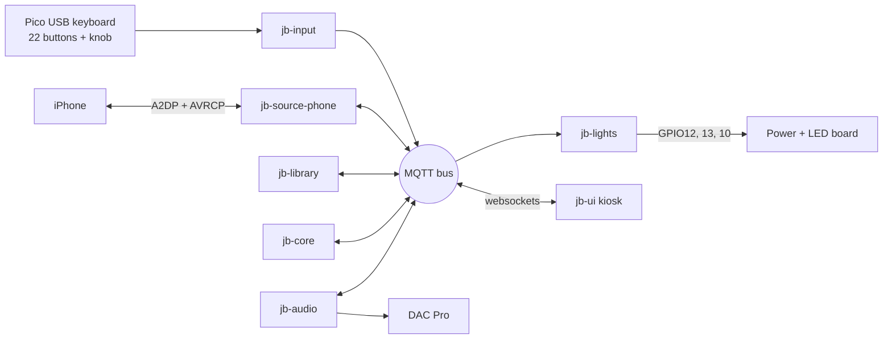

# Virtual Jukebox — Development Plan

Sep 24, 2026 · @shawn · updated Oct 19, 2026

## Status (Oct 22, 2026)

The jukebox runs as an appliance on the Pi 5: an iPhone plays through it with the Juk3box Helper app (AirPlay) or over Bluetooth, the library syncs to the Neon theme, the keypad and knob pick and queue, the whole cabinet's lights put on a show from the music, and the house's AirPlay speakers can play along. A new owner sets it up from a phone (the setup wizard, over the jukebox's own Wi-Fi), and it updates itself from signed releases.

| Phase | State |
| --- | --- |
| 0 Foundation, 1 Audio | Done, with whole-home audio (Oct 18) |
| 2a Pico input | Done: program 2.0, installed and updated by the setup wizard (Oct 21). Encoder detent tuning and the coin-return retrofit open |
| 2b jb-input | Done (Oct 21): any keypad or keyboard, learn mode, knob calibration, settle times. The gesture mapping isn't wired |
| 2c LED board | Done, all three chains with audio and at their caps. **Open: the level bar's strip 19-20 joint** (working now; reflow it) |
| 3 Phone link test | Answered |
| 4 Phone source | Bluetooth and the Helper app, one phone in charge at a time (Oct 20). Open: a second phone with a library; Bluetooth reliability in the cabinet |
| 5 Library | Done. Open: real artists and albums, play counts for a popular view |
| 6 Core | Done except: Up Next removal (gesture undecided), play counts; check Cancel clears an entry after the controls rewrite |
| 6b Lights | Done, on the Pi 5's PIO driver (Oct 20) |
| 7 UI platform | Done; Neon is the default (Oct 21) |
| 7b Admin, 7c Page builder | Done: setup wizard, Setup (name, updates, Last.fm), Menus (was Settings), the cabinet's one name moving its address (Oct 21) |
| 8 Appliance | Services ride out the bus restarting, and the bus can always restart (Oct 22). Open: the live netwatch test, log rotation, read-only root, cold boot under a minute, pull-the-plug tests |
| 9 Hard drive | Done (Oct 14) |

### Next (Oct 22, 2026)

1. **The card image**: build one and start a copy (the code is in place; no release has been made yet).
2. **Security**: the bus is open to anyone on the network (see Roadmap item 4).
3. **An Updates tab** (proposed Oct 22): everything that updates, in one place, with automatic updates on or off.
4. Waiting on hardware or the owner: the level bar joint; an Android phone (Roadmap item 3); the App ID's hotspot capabilities; WMM off in setup mode.

## Architecture

The jukebox is a Bluetooth-only appliance: an iPhone pairs like it would to a car head unit, A2DP carries audio, and AVRCP handles library browsing and control. BlueZ runs Bluetooth, PipeWire routes audio to the DAC Pro, and WiFi is used only for SSH admin. AirPlay was evaluated and dropped as a *source* because a receiver cannot query or select from the phone's library. It's back in two roles: whole-home audio sends the cabinet's sound out to an AirPlay zone (Oct 18), and the planned helper app ([docs/JUK3BOX_HELPER_BUILD_PLAN.md](docs/JUK3BOX_HELPER_BUILD_PLAN.md)) gives the jukebox the library over Wi-Fi and plays to it over AirPlay 2, as a second phone source beside Bluetooth (Bluetooth stays).

Music sources are pluggable. The phone is the first source adapter; library, core and UI talk to one source interface (browse, play item, now-playing, artwork), so Hard Drive and Spotify become new adapters, not rewrites.

Services never call each other directly, only through the bus, so each can be built and tested alone.

| Service | Owns |
| --- | --- |
| jb-input | Pico key and encoder events to logical actions; gesture engine (click, double, hold, push-and-turn) |
| jb-audio | DAC, local mixer volume, mute |
| jb-source-phone | Pairing, phone registry, connect/disconnect/switch, AVRCP browse, transport, now-playing, artwork |
| jb-library | SQLite cache per source and per phone: crawl, change detection + diff, sort views, local play counts |
| jb-core | Current page, sort mode, letter + digit entry, selection queue, menu state |
| jb-lights | Button pixels, accent strip and volume/level bar: scenes driven by jb-core state, audio level from PipeWire, per-frame current limiter |
| jb-ui | Web song board in a Chromium kiosk, subscribed to MQTT over websockets |

Stack: Pi OS Lite 64-bit, Python 3 + asyncio, dbus-next (BlueZ), evdev, aiomqtt, SQLite, PipeWire/WirePlumber, sway + Chromium (kiosk, app mode), aiohttp (jb-ui), rpi_ws281x + spidev (jb-lights), mosquitto. The Pico runs CircuitPython.

## Hardware

A single Raspberry Pi Pico, presenting as a USB keyboard, reads every control on the Rock-Ola 435 front panel: 24 of its 26 GPIO, 2 spare.

| Part | Role | Notes |
| --- | --- | --- |
| Raspberry Pi 4 | Main computer | Owned; powered through the header from the board's Pi branch |
| Raspberry Pi DAC Pro HAT | Audio out | Uses GPIO 0–3, 18–21, 27; has a 40-pin pass-through header |
| Raspberry Pi Pico | Input controller, USB keyboard HID | **Bought.** CircuitPython; reports press/release only; keyboard only, no LEDs |
| 20 selection keys | A–K (no I) and 1–0 | 10 × 10 = 100 slots per page; momentary, non-latching |
| Reset button | Momentary switch | Gesture input |
| Coin-return button | Converted to rotary encoder + push switch; volume knob | Mechanical retrofit, see Phase 2a |
| KY-040 encoders (6-pack) | Bench prototyping | **Bought.** Power from 3.3V; SW needs internal pull-up |
| Bourns PEC11R | Optional final encoder | Same pinout, drop-in upgrade |
| 23× SK6812 RGBW pixels | One under each of the 20 keys, Single Play, Album Play and Reset | BTF 10 mm boards, natural white, GRBW, 5V, 60 mA max each. Chain order: K…A, Single, Album, 1…0, Reset |
| WS2812B accent chain, 349 px (as built, Oct 12) | Accent lighting | One chain on GPIO13: the **upper panel** (pixels 1-189), then a jumper to the **footlights panel** (190-349), 4 rows of 40 facing down onto the front grill, serpentine, front row first: 190-229 left to right, 230-269 right to left, 270-309 left to right, 310-349 right to left. 5V, GRB; up to ~21A at full white (hence the 6A cap) |
| LED board (custom PCB, Rev E) | One 5V input, five fused branches, two Adafruit Pixel Shifters for four LED data lines | Stacks on the DAC Pro; see LED and power board |
| Mean Well LRS-150F-5 | 5V supply for the Pi and all LEDs, 5V 22A (110W) | As built (the plan had the LRS-200-5); fanless; set to 5.2–5.25V; one 12 AWG pair to the board. The ~14A budget fits |
| Monitor | Song board display | Size and resolution TBD |
| USB Bluetooth dongle + extension | Fallback only | Only if in-cabinet range is weak. Being decided (Oct 19): the built-in radio drops frames in bursts; a distance test comes first |
| Volume / level bar | Volume and sound-level meter | As built: 36 vertical strips × 5 WS2812B = 180 px (the original plan was 32 × 6), in a diffused aluminum channel. Strip 1 at the left, each strip bottom → top, no serpentine |
| Fosi BT30D Pro | 2.1 amplifier (TPA3255) | Runs on its own 48V 5A brick inside the cabinet |
| IEC inlet + internal power strip | One cord, one switch for the whole cabinet | Switched inlet with 5A slow-blow fuse; feeds the Mean Well and the amp brick |

Pin budget: 21 switches + 3 encoder pins (A, B, SW) = 24 GPIO. Every switch wires GPIO to ground with the Pico's internal pull-ups, no resistors. Keep the encoder on 3.3V; the Pico is not 5V tolerant. Debounce around 20 ms in firmware to handle decades-old contacts, and clean them with DeoxIT.

The 435 keyboard does not latch: each key is a momentary press that shorts two wires.

## LED and power board

One board, stacked on the DAC Pro, takes all LED and Pi power in at a single point (J2) and splits it into fused branches: Pi, button pixels, accent strip, level bar and a spare 4th LED channel. It also lifts the LED data lines from 3.3V to 5V with two Adafruit Pixel Shifters (#6066). Current design: Rev E (schematic: `docs/jukebox-power-board-revE.png`). Rev C's 74xx125 level shifter (U1) was dropped: it passed every DC test but couldn't pass the LEDs' fast pulses. (The separate Jukebox LED Board page still shows the older Rev B and is out of date.)

### Cabinet power: one cord, one switch

- Panel-mount IEC inlet with switch and 5A slow-blow fuse, feeding a small power strip inside the cabinet.
- Mean Well LRS-150F-5 (5V 22A, fanless; the plan had the LRS-200-5), set to 5.2–5.25V, sends one short 12 AWG pair to the board's J2.
- The Fosi BT30D Pro amp stays on its own 48V 5A brick. It needs 48V; at 5V it would make under 1W.

### Branches

| Branch | Fuse (resettable PTC) | Feeds | Leaves board at | Budget |
| --- | --- | --- | --- | --- |
| Pi | F1 5A | Pi 4 + DAC Pro through header pins 2 and 4 | J1 | 3A |
| Buttons | F2 1.85A | 23 SK6812 RGBW | J3 (JST-XH 3-pin) | Well under 1A (idle is the white channel at 70%) |
| Accent chain | F3 8A | WS2812B, 349 px: upper panel 189 + footlights 160 (as built) | J4 (3-pos screw terminal) | 6A limiter |
| Level bar | F4 5A | 36 strips × 5 WS2812B = 180 px | J5 (3-pos screw terminal) | 4A limiter |
| 4th channel | F5 (size to the load) | Spare, WS2812B or SK6812 | J6 (3-pos screw terminal) | TBD |
| **Total through J2** |  |  |  | **\~14A** |

### Data

| Chain | GPIO (header pin) | Drive | Strip type | Shifter path (Rev E as built) |
| --- | --- | --- | --- | --- |
| Buttons | GPIO12 (32) | PWM0, rpi\_ws281x channel 0, DMA 10 (root) | SK6812\_STRIP\_GRBW | U1 DAT → **!D5** (inverted) → R1 330Ω → J3. Driven with `invert=True` |
| Accent strip | GPIO13 (33) | PWM1, rpi\_ws281x channel 1, DMA 10 (root) | WS2811\_STRIP\_GRB | U1 CLK → C5 → R2 330Ω → J4 |
| Level bar | GPIO10 (19) | SPI via spidev (no root) | WS2812B GRB | U2 DAT → D5 → R3 330Ω → J5 (reworked, see below) |
| 4th channel | GPIO6 (31) | SPI4 MOSI (`dtoverlay=spi4-1cs`, `/dev/spidev4.0`) | TBD | U2 CLK → C5 → R4 330Ω → J6. Untested |

**Why a level shifter.** An LED chip reads a data 1 only above about 70% of its 5V supply (3.5V). The Pi outputs 3.3V, which is why the Sidecar strip failed direct from a GPIO. Each Pixel Shifter has a 74HCT2G34 buffering both channels (DAT → D5, CLK → C5) plus an inverted copy of DAT on !D5, and a charge pump that makes 5V from its V pin, so powering V from the Pi's 3.3V is correct. A tiny WS2812B on the board's D5 output lights with the first pixel's color: a handy "is the signal arriving" check.

**Rev E lesson: the output terminal order.** On the real #6066 the output block reads, from the G end: **G, D5, !D5, C5**. The Rev E schematic drew the outputs in a different order, the board was built from the physical position, and both data lines landed on **!D5**, the inverted output. An inverted signal looks like nothing to the LEDs: they ignore every frame and sit in their power-up white. Fixes, Oct 10-11:
- Buttons: left on !D5 and inverted in software (rpi\_ws281x `invert=True`; PWM inverts in hardware, so it's reliable). With no program running the pin falls low and the line sits high, so jb-lights parks GPIO12 as an output driven high when it stops. From power-up until jb-lights starts, the buttons may show junk.
- Level bar: SPI can't invert (the kernel rejects `SPI_MOSI_IDLE_HIGH` on this controller, and a software pin-switching workaround missed frames under load), so U2 was reworked: trace cut at the !D5 pad, jumper from **D5** to R3.
- Next board revision: fix the terminal order in the schematic and footprint.

### Board rules

- The Pi is powered through header pins 2 and 4 from its own fused branch. No USB-C cable.
- After the build, run `vcgencmd get_throttled` with the lights bright; it must read `0x0`. If not, raise the supply toward 5.25V or swap F1 for a 5A blade fuse (lower voltage drop).
- Keyed XT60 input, so no reverse-polarity diode is needed.
- Software caps in jb-lights: accent strip 6A, level bar 4A. Buttons idle on the white channel at 70% (23 px, well under the 1.85A fuse). PTC fuses hold about 20% less when warm.
- C1 2200µF sits at the split point; C4 1000µF goes across the strip's input wires (off board).
- Accent strip power is injected at start, middle and end, with all three taps landing at J4.
- Order 2 oz copper; use wide pours on the input, strip and bar paths.
- Measure DAC Pro jack height against the stack gap before choosing the header height.
- Removed since Rev B: Mini560, D1 diode, JP1 jumper, pull-down resistors, power LED.

Free GPIO with the DAC Pro fitted: 4–17 and 22–26. The board uses 6, 10, 12 and 13, plus 3.3V, 5V and GND.

## Phase 0: Foundation

A bare Pi you can deploy to and a bus you can watch from your laptop.

- [x] Flash Pi OS Lite 64-bit; set hostname, SSH keys, mDNS name (`juk3-box.local`)
- [x] Repo layout: /services/\<name>, /shared (bus client, config, logging), /firmware/pico, /deploy
- [x] rsync + restart deploy script (`deploy/deploy.sh <service>`); shared systemd unit template, or a service's own unit in `deploy/systemd/` (jb-lights runs as root)
- [x] Install mosquitto with a websockets listener (1883, 9001)

Done Sep 27.

Done when: a heartbeat service is visible on the bus from your laptop.

## Phase 1: Audio out (jb-audio)

Clean audio from the DAC Pro, with volume controlled over the bus.

- [x] Enable the DAC Pro overlay; disable onboard audio (the HAT auto-detects; no overlay needed)
- [x] PipeWire + WirePlumber with the DAC as the default sink (WirePlumber runs the `main-embedded` profile, required for headless Bluetooth)
- [ ] Test with speaker-test and a WAV: both channels, no noise or clipping (clean so far, but only the right speaker is connected)
- [x] Volume is the local mixer; the phone stays at full volume
- [x] Service handles volume up/down deltas and mute from the bus; publishes the current level (retained)

Done when: a clean tone plays and volume changes by bus message.

## Phase 2a: Input hardware (Pico)

Every physical control produces a keycode.

- [x] Meter the 435 keyboard: wired as a 4×5 matrix (GP5–8 rows, GP9–13 cols), Reset NC on GP14, encoder GP2/3/4. Spec: `Keyboard Input Build Brief.md`
- [x] CircuitPython firmware (`firmware/pico-keypad/`, USB name "Jukebox JB Keypad"): all 20 keys, Reset, knob push and turn bench-verified; hold A while plugging in for the CIRCUITPY drive
- [ ] Bench-test a KY-040; tune steps per detent (works, 22 steps per turn with no lost clicks; detent tuning still open)
- [ ] Coin-return retrofit check:
  - Can the plunger rotate, or is it keyed? Remove the key if so
  - Hard stop so the plunger never bottoms out on the encoder switch
  - Zero-play coupling from plunger to the encoder's 6 mm shaft (3D-printed sleeve)
  - Keep the stock return spring
  - Turns smoothly while pressed (needed for push-and-turn)

Done when: every control shows the right keycode in evtest.

## Phase 2b: Input service (jb-input)

Raw keys become logical actions; runs in parallel with 2a using any USB keyboard.

- [x] Keycode to logical name mapping in a config file (`/etc/juk3-box/jb-input.json` overrides the defaults)
- [x] Gesture engine: click, double-click, hold, push-and-turn, with configurable thresholds. Built but OFF by default: today the knob turns and clicks, and the keys and Reset report presses
- [x] Publish logical actions: `jukebox/jb-input/key` (`{key, kind}`), `/gesture`, `/action`, `/status`; the UI takes the knob from here
- [ ] Wire up the draft gesture-to-function mapping below

Done when: every gesture fires reliably with no false triggers.

### Gesture-to-function mapping (draft)

Ideas from a 2026-09-27 design conversation, not yet implemented — captured here so Phase 2b's gesture engine and the phases that own each function (noted below) have a starting point instead of designing from scratch. All of it lives in config per the Phase 2b design, so it costs nothing to change once real use reveals what actually feels right. The 20 alphanumeric keys are deliberately excluded: their function is purely positional (which letter, which digit), so a single press each is all they should ever need.

- **Now Playing** (function owned by Phase 4/6 transport, gesture routed through jb-core's queue so it stays authoritative rather than issuing a raw "next"): click = play/pause toggle; double-click = skip to next track; hold = previous/restart current track.
- **Volume**: double-click = toggle mute (jb-audio's `toggle_mute` command already exists — see `services/jb_audio/main.py` — nothing currently triggers it), distinct from the existing single-click-to-enter-slider-adjust-mode.
- **Phone** (Phase 4): click = quick glance at who's connected (already built); hold = open the phone pairing/management screen (pair new, forget old) — keeps the common case uncluttered by the rarer, more deliberate one.
- **Reset** (built Oct 12, the user's design): click = cancel a waiting letter, or the power menu; **hold 1 s** while a song plays = cancel the song (the next queued plays; nothing queued = stopped and cleared from Now Playing); hold with nothing playing = the power menu; **keep holding to 4 s** during music = cancel, then the menu with playback paused. The menu: Reboot / Shut down / Cancel by the knob, starting on Cancel; Reset click or 20 s = cancel and resume. The Reset light is red while held and blinks twice on the cancel and again when the menu opens.
- **Up Next — still undecided**: how to remove a specific queued item once it's reachable via Up Next's scroll mode (click vs. hold). Needs a decision before Phase 6/7 implement it.

## Phase 2c: LED board build

The lighting hardware, built and proven before any animation code. Runs in parallel with 2a and 2b.

- [ ] Measure DAC Pro jack height; fix J1 header height and standoffs
- [x] Design, lay out and order the board (now Rev E with two Pixel Shifters); built and stacked
- [ ] Set the Mean Well to 5.2–5.25V before connecting anything
- [ ] Board only, no Pi: 5V at J2, each branch output reads 5V
- [ ] Stack on the DAC Pro and power the Pi through the header; run `vcgencmd get_throttled` under load (must be `0x0`)
- [x] Pi on, audio playing: button chain on GPIO12 (SK6812\_STRIP\_GRBW), listen for clicks and watch for flicker
- [x] Accent strip on GPIO13; build the three injection taps and C4; full-white test at the 6A cap, every point ≥ 4.7V
- [x] Build the level bar (as built 36 × 5 px); run it on GPIO10 (SPI on, core\_freq=500, core\_freq\_min=500). Works through U2 after the D5 rework (Oct 11)
- [x] Run the bar with audio and both other chains running
- [x] Re-run `vcgencmd get_throttled` with all three chains at their caps
- [ ] Level bar: reflow the intermittent joint between strips 19 and 20 (working now; when it lets go, strips 20-36 freeze or go full white)
- [ ] Confirm button key caps: translucent (even glow) or opaque (halo); check clearance under each key
- [ ] Next board revision: correct the Pixel Shifter output order (G, D5, !D5, C5) so no rework or software inversion is needed

Done when: all chains run test patterns while music plays, with no audio artifacts. Waiting on the accent strip build.

## Phase 3: Phone link test (decision gate)

Throwaway test code that answers ten questions before any real phone service is built. The Pi runs as an A2DP sink and AVRCP controller; pair an iPhone and record results below.

**Intentional: A2DP + AVRCP only, never HFP/HSP.** The jukebox should only ever receive media playback audio (Music, Spotify, Podcasts, etc.), never phone calls, Siri, or system/notification sounds. iOS decides what to route to a Bluetooth device based on which profiles it advertises — A2DP-only makes it look like a plain speaker, so calls/Siri/system audio stay on the phone. Adding HFP/HSP later would make the jukebox a usable speakerphone, which is explicitly not wanted; don't add those profiles without revisiting this decision.

| # | Question | Decides | Result |
| --- | --- | --- | --- |
| 1 | Do streaming/Apple Music library items appear, or only downloads? | What the board can show | Partly answered: the whole folder tree browses (My Music → Artists/Albums/Songs/Genres…, Playlists, Radio, Audiobooks), and Songs listed all 910 library tracks. Streaming-only vs downloaded not separated yet |
| 2 | Does PlayItem (play a specific track by ID) work? | Whether selection works at all | **Yes.** `MediaItem1.Play()` plays that exact song |
| 3 | Full crawl time for the library (track count + seconds) | Sync UX | 910 tracks in one `ListItems` call, near instant. A stuck crawl now times out at 120 s |
| 4 | Are track IDs stable across reconnects; does the change counter work? | Caching strategy | **Not stable.** Item paths die whenever BlueZ recreates the player (reconnect, or the phone switching audio apps), and player names get reused. Change counter not tested |
| 5 | Negotiated codec: AAC or SBC? | Audio quality | **SBC.** Worth checking whether AAC can be preferred later |
| 6 | End of track: can the jukebox queue override iOS auto-advance? | Queue strategy | **Yes**, after the fact: iOS advances seamlessly, but a `PlayItem` sent right after cleanly overrides it every time |
| 7 | Metadata available for sorting (title, artist, album, recently added) | Sort views | **Title only** when browsing. Full metadata arrives only for the playing track |
| 8 | Does cover art arrive over AVRCP, and for which tracks? | Artwork strategy | **No.** No art in any metadata |
| 9 | Do position and duration update well enough for a progress bar? | Now-playing strip | **Yes.** Position updates; the UI interpolates between updates |
| 10 | Pi-initiated reconnect with the iPhone awake vs. asleep | Auto-reconnect and switching | **Works** when the Pi connects the A2DP profile (classic Bluetooth); a plain Device1.Connect often went to LE and hung. Reconnects at boot automatically |

Output: a findings note plus the caching, queue and artwork strategies. As decided:
- **Caching:** tracks keyed by (phone, title, duplicate index); a fresh sync on every new BlueZ player, navigating by folder contents; a failed pick re-syncs and replays the same song (self-heals in about 2.6 s).
- **Queue:** jb-core watches now-playing; a title it didn't command means iOS auto-advanced, so it plays the next queued song over it. With an empty queue, it accepts iOS's pick.
- **Artwork and artist/album:** looked up by title from the iTunes Search API. These are guesses (e.g. duplicate titles share one artist). Planned fix: read real artists from the phone's My Music → Artists folder. During development WiFi is busy (deploys, apt), so suspect WiFi/Bluetooth coexistence before BlueZ if audio drops.

## Phase 4: Phone source (jb-source-phone)

Pairing, multiple phones, and switching between them, built on the Phase 3 findings.

- [x] Pairing mode from the menu: discoverable for 2 minutes under a fixed name, 6-digit code on screen, confirm on the jukebox; invisible otherwise (Oct 14; pairing.py, our own BlueZ agent; tested with a MacBook, confirmed from the admin)
- [x] Phone registry: name, last seen; connect, disconnect, forget (Oct 14; forget also deletes the phone's library; tested with a MacBook)
- [x] Switch sequence: pause current phone, disconnect, connect new phone, load its cached library (Oct 14; Mac -> iPhone in 5.5 s, its 910 songs back at once)
- [x] Connection policy: locked (Oct 14, phones.py): a mid-song drop holds the place for the reconnect window, an idle drop frees it, switching from the jukebox always works. Tested: pairing the Mac turned the iPhone away. A device connected for audio only (a laptop) counts as connected, with no song list
- [ ] Still to test: a second phone with its own library (pair, switch both ways, forget with a real library); Android (roadmap item 3)
- [x] Auto-reconnect on boot: last active phone, then others by most recent use (Oct 12; `reconnect.py`). Policy (user's option C): at boot try for 10 min; after a drop **mid-song** try for 3 min; a drop while idle is left alone (it may have been the owner's choice, and calling the phone would pull its audio away). Connects the A2DP profile, which forces classic Bluetooth -- a plain Connect let BlueZ wait for the iPhone on LE forever. Verified: reconnected 25 s into boot, first try
- [x] Publish the connected phone's name (`jukebox/jb-source-phone/connected`, retained: `{connected, name, mac}`)
- [ ] Implement the common source interface: browse, play item, transport, now-playing, artwork. Built for the phone (crawl, `play_item`, play/pause/next/previous, now-playing; artwork comes from jb-library), but not yet as a shared interface other sources plug into
- [x] Reconnect hardening: retries while BlueZ finishes building the player; library sync waits for browsing to appear; a failed pick re-syncs and replays
- [x] Sync hardening (Oct 11): waits until the phone lists items, waits out BlueZ "busy" (it fetches whole folders in the background), retries, and resets the browse session with a reconnect when lost or out of retries (never while playing, at most every 5 min)
- [x] Browse lease: jb-crawl's deep crawl takes turns with the library sync; a pick always wins
- [ ] Phone button hold gesture opens the pairing/management screen, distinct from a plain click's quick-glance status (see the gesture-to-function mapping in Phase 2b)

Done when: the phone reconnects on boot, two phones switch from the command line, and a track ID on the bus plays that song.

## Phase 5: Library (jb-library)

A per-phone cache so the board appears instantly.

- [x] SQLite keyed per phone (`/var/lib/juk3-box/library.db`): tracks (with duplicate titles), last played, added, favorites, iTunes artwork/artist/album/genre. Play counts not yet
- [x] Sync: jb-source-phone drives it (a fresh crawl per new BlueZ player, since IDs aren't stable); jb-library stores, prunes songs gone from the phone (skipped if a sync looks short) and republishes only on change
- [x] Fallback for unstable IDs: the cached board shows instantly; IDs refresh on sync, and a dead ID self-heals on pick
- [ ] Sort views: title, artist, album, recent, popular. Title, artist/album/genre drill-down, New and Recents work; popular needs play counts; artist/album are iTunes guesses until read from the phone's Artists folder
- [x] Deep crawl (jb-crawl, separate capped service): Playlists live (a Home module and a board sort). Artists/Albums/Genres work but take ~19 s per folder over Bluetooth, so they're disabled on the Pi (`/etc/juk3-box/jb-crawl.json`). Findings and tools: `tools/avrcp/`
- [ ] Album Play and real artist/album: decide the route -- an iPhone Shortcut that sends the full library over Wi-Fi (exact, seconds, no Bluetooth browsing) vs. a resumable, incremental Bluetooth crawl (hours the first time; risk of wedging the phone's Bluetooth)
- [x] Serve pages of 100 slots (the UI pages the snapshot; 10–100 per page, owner setting)

Done when: switching back to a known phone shows its library instantly and every sort view is correct.

## Phase 6: Jukebox core (jb-core)

The jukebox behavior, working end to end with no UI.

- [x] Slot labels A1–K0: each screen column holds two letters (A/B, C/D, E/F, G/H, J/K); digits run 1–9, then 0
- [ ] Entry state machine: letter highlights its 10-slot block, digit completes; cancel or timeout clears (`jukebox/jb-core/entry`, `/selection`). Letter, digit and the 10 s timeout work; **Reset doesn't cancel yet** (jb-core ignores it)
- [x] Paging and sorting (in the UI engine); menu state comes with the Settings and phone screens
- [x] Selection queue using the Phase 3 end-of-track strategy; shuffle (picks go ahead of shuffle's own; turning shuffle on starts playback). Clearing the queue on phone switch comes with Phase 4 switching
- [ ] Record plays for the popular view (last played is recorded; counts aren't)
- [ ] Now Playing double-click (skip to next) and hold (previous/restart) drive through this same queue mechanism, not a raw transport command (see the gesture-to-function mapping in Phase 2b)
- [ ] Up Next item-removal gesture, once decided (see the open question in Phase 2b's gesture-to-function mapping)

Done when: select, queue three songs, they play in order, and paging and sorting change what each key selects.

## Phase 6b: Lights (jb-lights)

The buttons and cabinet respond to what the jukebox is doing. Runs as `jb-lights.service` (root, starts at boot): buttons in the main thread, the level bar in its own thread. Code in `services/jb_lights/`.

**Buttons: buttons-theme1** (the user's design, Oct 10; replaced the original red/amber table):

| State | Selection keys | Reset button |
| --- | --- | --- |
| Idle | All white (white channel, 70%) | White |
| Letter chosen | That letter green; another letter moves the green | Red (can cancel) |
| Digit chosen after a letter | That digit green too, then a rainbow comet runs A…K, 1…0 twice, then back to idle | Off during the comet |
| Digit with no letter | That digit blinks red 3× (not a valid start) | White |
| Reset while a letter is held | Back to idle | White |
| Menu open, pairing | To design | To design |

- [x] Pixel-index to button map (`buttons.py`; chain order K…A, Single, Album, 1…0, Reset)
- [x] buttons-theme1 (`themes/buttons_theme1.py`), currently driven straight from jb-input key presses
- [ ] Drive the button lights from jb-core's entry state instead of raw keys, so the lights, the board and the 10 s timeout always agree
- [ ] Menu and pairing scenes; accent-strip scenes (idle, playing, selection)
- [x] Per-frame current limiter for the level bar (4A); estimate draw from pixel values and scale the frame
- [ ] Limiter for the accent strip (6A)
- [ ] Optional: warm the natural white slightly with a touch of red

**Level bar** (the user's design, Oct 11; replaced the fill/meter modes):
- At idle: colour stripes beside the city (Oct 19: each strip its own colour, red, green, blue, amber, cyan, magenta, at 20%, ~0.7A, cooler than white), and the flowing ribbon during the idle waves. The old idle (all white at the 4A cap, about 37%) is still theme 0.
- While the knob turns: the volume fill (white columns, left to right = volume) crossfades in, holds 3 s after the last change, then fades back.
- While music plays: its part of the light show (Oct 18), from jb-analyzer's stream; see [docs/Light Show Styles.md](docs/Light%20Show%20Styles.md).

- [x] Volume from jb-audio (`jukebox/jb-audio/state`); volume fill overlay (`themes/volume_bar_theme4.py`, `levelbar.py`)
- [x] Matrix layout 36 × 5 (`matrix.py`, index = column × 5 + row)
- [x] Idle look in the service: colour stripes (`themes/volume_bar_stripes.py`); all-white (`themes/volume_bar_idle.py`) kept as theme 0
- [x] Sound and mood from jb-analyzer, which listens inside the Pi (Oct 18)
- [x] The light show picks the bar's scenes to fit the music (Oct 18)

Done when: a full select, confirm and reset sequence plays on the keys within about 20 ms of each press.

## Phase 7: UI platform (jb-ui)

**Goal: the UI is a platform, not a theme, built the way WordPress is.** Juk3box is meant for public release. Anyone can install it, apply a theme to change the look and the layout, and later add plugins for new abilities. The aim is to be a big step above fruitbox: easy install, easy modification, and the Bluetooth phone link.

The first build (Sep 27–Oct 6) proved the behavior on real hardware: song board, Now Playing, Up Next, sort drill-down, knob navigation and keypad selection. That page has its look and logic mixed together and is replaced by this design. The behavior carries over.

Mockups for the default theme are in `Images/Theme/` ("home mockup", "browse all mockup"). Their labels, song counts and logo are placeholders.

### Three layers

| Layer | What it is | Who makes it |
| --- | --- | --- |
| Platform | The services, plus a UI engine in the kiosk that owns all behavior: bus data, the knob highlight and focus order, letter + digit selection, screen changes, popups, the return-to-Home timer | The project |
| Theme | A folder with no code: layouts per screen, block templates, colors, fonts, images, background. Changes the look and the arrangement | Anyone |
| Plugin | Adds abilities: quick sorts, blocks, sources, light shows. Code, so it gets an API and a trust model | Later |

A theme never talks to the bus or reads the knob. It places blocks; the engine fills them with live data and makes them selectable.

### Rules

- Themes can rearrange screens, not just restyle them.
- Responsive: one theme fits any monitor size and aspect ratio. Size with relative units and grid, never fixed pixels for the screen.
- Themes are data only (JSON layouts, HTML block templates, CSS, images, a manifest), so installing one can't run code. Plugins come later with their own rules.
- Layouts are structured data (a JSON tree of containers and blocks), not free-form HTML, so a drag-and-drop page builder can open and save them (Phase 7c). The owner's edits are saved separately from the theme; resetting brings back the theme's default.
- Three parties, like WordPress: the engine decides behavior, the theme decides look and arrangement, the owner decides what's switched on (nav buttons, songs per page, active theme) and each module's settings. Home rows are modules in the layout with their own settings (Browse categories, card count, See All, shown or hidden), like page builder modules; See All opens the row's full page, like a WordPress archive.
- Not gatekept: the theme format is documented, and the default theme is the worked example to copy.
- The knob's focus order comes from the layout's reading order (left to right, top to bottom), computed by the engine. No hand-kept order lists.
- Every block copes with missing data: no cover, no artist, no length, no phone connected.
- Lean: plain HTML/CSS/JS, no framework and no build step. Chromium runs on a 1 GB Pi.
- Public-ready: no personal details in code (network, names, keys live in config), a theme format version number. License: GPL-3.0 (decided 2026-10-08), so distributed copies stay open source.

### Blocks (first set)

Nav bar, Now Playing, Up Next, song board (10 to 100 slots per page, owner setting; codes always match the keypad), Home sections (New, Recents, Featured Artist, Browse), song card, popup. Full spec: `docs/theme-format.md`.

Home cards are knob stops. Song cards (New, Recents) pick the song like the keypad does. Link cards (Browse sorts, Featured Artist, which the engine picks at random) open the board in that sort or filter.

### Picking a song (keypad or card)

- Nothing playing: it plays now.
- Something playing: it joins the queue.
- Shuffle on: it goes to the front, ahead of shuffle's own picks.
- Owner setting, off by default: a pick interrupts and plays immediately.

### Default theme (the mockups)

- Left sidebar: logo, Home / Volume / All Songs / Settings, Now Playing (cover, title, artist, album + year, progress), Up Next list.
- Home: New (featured cards), Browse (four quick-sort cards, which sorts TBD), Recents (row of cards).
- All Songs: the 100-slot board as dark cards (code, cover, title, artist, length).
- Neon tunnel background.

### Navigation

- Home is the resting point (replaces Volume). After idle, focus returns to Home.
- From Home, clockwise moves into the Home page's cards, scanning left to right, top to bottom. Counter-clockwise moves down through the nav bar.
- Click is the only knob gesture for now. Letter + digit selects a board slot.
- The highlight returns to Home after a short idle (12s); the screen stays where it is (a sorted board stays sorted). Only when nothing is playing and the jukebox has been idle for the owner's set time (`idle_home_minutes`, default 5, 0 = never) does the screen go back to Home.
- A keypad letter brings up the board if it isn't showing.

### Backend additions

- [x] Recents: songs played 30s or more, most recent first (jb-library's last_played_at)
- [x] New: songs that appear on a later sync than the phone's first (jb-library's added_at), newest first, then alphabetical
- [ ] Song length and album year from the iTunes lookup
- [x] Featured Artist: a random artist with a cover, at startup and every 30 minutes
- [x] Favorites: marked from the Now Playing overlay (jb-library `favorite`, `jukebox/jb-library/cmd`)
- [ ] Favorites as a Home section and a sort. Check whether the phone's Playlists folder over AVRCP exposes iOS's Favorite Songs to seed it
- [ ] Owner setting: a pick interrupts the current song (off by default)

### Build order

- [x] Theme format spec: manifest, layouts, block templates, style variables, format version (draft, `docs/theme-format.md`)
- [x] UI engine: bus data, focus/knob, selection, screens, popups (jb-ui serves it on 127.0.0.1:8090)
- [x] Blocks above, unstyled but working
- [x] Default theme from the mockups ("Neon", rebuilt from the Oct 9 mockups)
- [ ] Prove it: a second, deliberately different test theme rearranges the screens with no engine changes; test at two monitor sizes
- [x] Now Playing overlay (full-screen glass; Favorite, Close), See All views, header with Back, EQ Now Playing icon, Lucide icons (Iconify format, bundled), art-sampled card glows
- [ ] Phone badge (top right): manage phones from it -- connect, switch, forget. Stubbed for now (shows who's connected); built with the phone connection manager
- [ ] When a pick fails because another app (audiobook, video) has the phone's audio, the screen says to open Music. Better: detect it before the pick
- [ ] Screens from the old plan, still needed: phones (list/connect/disconnect/forget), pairing (code + countdown), no phone, syncing (progress)
- [ ] Cabinet Settings screen (knob-friendly quick toggles): theme switcher, Home rows on/off (edits the module's `show` setting), nav buttons, songs per page, and the jb-admin address with a QR code
- [x] Background videos optimized by the platform (jb-ui media.py): re-encoded once to H.264 <=1280x720 at 30 fps, cached in /var/lib/juk3-box/cache/video, remade when the original changes; the kiosk plays it with Chromium's zero-copy hardware decoding
- [ ] Glass effects over the video must not use backdrop-filter (halves the frame rate on the Pi); add this to the theme guide
- [ ] Later: plugin API

Done when: the default theme matches the mockups on the real monitor, and a second theme can rearrange it without touching the engine.

## Phase 7b: Admin (jb-admin)

Setup and management from a phone or laptop browser, like Sidecar's admin page. A separate service from jb-ui: the kiosk server only listens on the Pi itself, while jb-admin is reachable on the network behind a login. If jb-admin crashes, the jukebox keeps playing.

- [x] Login; the service listens on the network, the kiosk server doesn't (jb-admin on :8080, one owner password set on first visit, Oct 13 2026)
- [ ] First-time setup wizard over a Wi-Fi hotspot: name the jukebox, join Wi-Fi, pair the first phone. Reuse Sidecar's lessons (WMM off for this Wi-Fi chip in AP mode; phones reset captive-portal pages, so progress is kept on the Pi)
- [x] Themes: upload as a zip, check the format, strip scripts, preview, activate, delete
- [ ] Settings: everything on the cabinet's Settings screen, plus sources, Browse card sorts, idle timeout, volume limits, New ordering, the pick-interrupts setting, API keys
- [x] Phones: pair, forget, switch (Oct 14, the admin's Bluetooth page); re-sync from the admin still open
- [ ] Maintenance: software updates, logs, restart, reboot
- [ ] Later: an installer, so anyone can set up Juk3box on their own Pi

Built so far (Oct 13 2026): Dashboard (now playing, phone, volume, theme, module health), Themes, Media library, Settings (nav buttons with drag to reorder, songs per page, idle time), Modules (the platform registry), Account. Settings has only the owner settings that exist so far; the rest of the list above comes as each setting is built.

Done when: a fresh Pi can be set up, themed and configured from a phone without SSH.

## Phase 7c: Page builder

Drag-and-drop layout editing in jb-admin, like WordPress's page builder: start from a blank page or the theme's layout, add, remove and reorder blocks, preview live with the real engine, save. Possible because layouts are JSON (Phase 7). Start simple (rows of blocks, reorder, add/remove) and grow.

- [x] Edit Home first, then any screen and the frame
- [x] Live preview using the kiosk engine
- [x] Owner layouts saved apart from the theme; reset to the theme default
- [x] Drag and drop from the palette or the structure tree, onto the tree or straight onto the preview; click the preview to select; undo/redo; drafts autosave, Publish reloads the cabinet; revisions (last 20); patterns; heading, text, image and spacer blocks; media library; layout helpers (row, column, grid). Works on a phone (Oct 13 2026)
- [ ] Pages of the owner's own, reachable from the nav

Done when: an owner can rebuild the Home screen on a phone and see it on the cabinet without editing a file.

## Phase 8: Appliance behavior

It behaves like a machine, not a computer.

- [ ] Boot order, auto-restart, watchdog. Partly there: every service restarts on failure, publish-only services exit when a task dies, and a clock jump at boot is survived (mosquitto drops clients when NTP jumps the clock; the kiosk uses native timers). The hardware watchdog is the Pi OS default (1 min)
- [ ] Phone leaves range mid-song; power cut during a sync
- [x] Power-loss-safe writes (Oct 14): every state file goes through shared/files.py (temp file, fsync, rename, fsync of the folder): phone book, Bluetooth on/off, crawl progress, jb-netwatch history, mood-tag cache, Weather Mix names; the optimized background video is synced before it counts as done. The admin's files already were; the library is SQLite (journaled, power-safe by default)
- [ ] Log rotation; read-only or overlay root filesystem
- [ ] Cold boot to a working jukebox in under a minute
- [x] Stays online on its own: jb-netwatch (Oct 14) reconnects the Wi-Fi, turns it off and on, and as a last resort reboots (at once for the Pi 4's hung brcmfmac driver, seen Oct 8, 13/14 and 14). Spaced-out reboots, never in a loop, waits for the song
- [ ] **Test to do: jb-netwatch live, end to end.** Turn the Pi's Wi-Fi off on purpose (`sudo nmcli radio wifi off`, from the Pi's own screen or a delayed command, since SSH goes with it) and watch it recover by itself in ~2 min: `offline`, `reconnect` at 1 min, `wifi-off-on` at 2 min, `back-online` in /var/lib/juk3-box/netwatch/events.jsonl. Then, ideally, a real driver hang should end in one `reboot` and a working jukebox
- [x] Reset hold opens a Reboot / Shut down menu (4 s during music, 1 s when idle) -- the physical recovery path (Oct 12; jb-core power.py, polkit rule deploy/polkit/)

Done when: 10 pull-the-plug tests pass in a row.

## Phase 9: Hard Drive source (jb-source-local)

A second adapter: local files on USB or SD with tags and embedded art, played through the same PipeWire output. Cheap to build, exact metadata and play counts, and a fallback if iOS disappoints in Phase 3.

**Decided Oct 14, 2026 (with the owner):**

- **Always merged, not either/or.** A drive isn't a device you switch to: its songs join whatever phone's library is showing (and are there with no phone at all).
- **Music plays from the drive; nothing is copied.** The Pi keeps only the index (tags, durations, play counts) and small cover thumbnails, capped. A USB stick reads far faster than audio needs, and decoding costs the same wherever the file is, so the SD card stays free for other things. The drive is mounted read-only. Unplugged, its songs leave the screen; plugged back in, they return, rescanning only new or changed files.
- **Pictures and videos are imported** into the admin's media library (resized / re-encoded for the Pi as uploads are), under a size cap for what one drive may import.
- **Formats:** MP3, AAC/M4A (incl. iTunes purchases), ALAC, FLAC, WAV; Apple Music subscription downloads are DRM-locked and are skipped with a note. Tags via tinytag (MIT), not mutagen (GPL) — see docs/extensions-inventory.md.
- **First step is the shared source interface** (core, library and UI talk to "a source", not jb-source-phone), then jb-source-local.
- **Built Oct 14, 2026** (8b67678, 5c2d2a8, 8590d8e and the Drives page commit): jb-drive mounts read-only on plug-in; jb-source-local scans and plays (mpv); jb-library merges; jb-core routes by item_path; pictures/videos imported (2 GB media cap). Drive albums join Browse > Albums with their songs in tag order (an album on the phone too is listed once and plays the drive's copies). A new drive puts only its 20 newest songs in New. Songs with no artist tag get no online guess. Admin **Drives** page: each drive (space, counts, skipped with reasons, Eject / Mount again, Forget for ones not plugged in), import settings, a **New** tab (songs by when they were found) and a **Songs** tab with "needs info" filter and editing. Edits live on the jukebox (drive_edits), on top of the tags; the drive is never written. The cabinet shows "Music drive connected" when one is plugged in.
- Open: write edits back into the files (would need a read-write mount); a drive's own cover art (embedded pictures or cover.jpg) instead of the online lookup.

## Phase 10+: Features

- Spotify source: Web API for browsing, librespot for playback, requires Premium
- Attract mode / screen saver (after long idle, beyond the return to Home)
- Credit/coin logic
- Playlist views
- Admin settings screen

## Roadmap (agreed Oct 14, 2026)

One at a time, in this order. Each item points at the phase that holds its detail.

1. **Phone management** (Phase 4, Phase 7 screens, Phase 7b Phones): pairing mode with a code on screen, the phone list (connect, forget), switching phones, the phone badge and the pairing / no-phone / syncing screens. *Built Oct 14: Settings > Bluetooth on the cabinet (on/off, phones, pairing; the user's design), the badge as a quick switcher, the admin's Bluetooth page. Tested with the MacBook: pairing, the lock, switching, forgetting. Left: a second phone with a library.*
2. **Pi 5 move**, when the board arrives. *Prepared Oct 14: [docs/pi5-move.md](docs/pi5-move.md) (move this SD card: it already has the Pi 5 kernel), `shared/hardware.py` board detection, jb-lights idles on a Pi 5 until its PIO LED driver is in.* The hardware is **chosen in setup** (detected from the board, confirmed by the owner) and the matching drivers and settings follow from it: LEDs (rpi_ws281x doesn't run on the Pi 5; an SPI or PIO driver instead), background video (the Pi 5 decodes HEVC in hardware, not H.264), Wi-Fi power settings, memory limits.
3. **Android go/no-go**, when an Android phone is at hand: the Phase 3 ten questions again (browse tree, play by item, metadata, art, reconnect). Android's AVRCP browsing differs from iOS's.
4. **Security before anyone else uses it**: change the owner password from its placeholder (Account → Change password already exists); the core services onto bus logins and anonymous bus access closed (Phase 8 hardening).
5. **First-boot setup wizard** (Phase 7b): over a Wi-Fi hotspot (Sidecar's lessons); name, Wi-Fi, time and region, hardware (item 2), sources, inputs (buttons, encoder, touch: calibrate and map keys) and the first phone, in one ordered flow. The plan: [docs/Setup Wizard — Plan.md](docs/Setup%20Wizard%20—%20Plan.md) (Oct 20).
   - **Hardware is self-serve (decided Oct 14).** Once the Pi 5 runs Juk3box, the image carries everything for both boards (both LED drivers, the `[pi4]`/`[pi5]` boot settings, both video profiles). The wizard detects the board, the owner confirms it, and it applies that board's settings by itself, with no hand edits and no outside help: a new owner won't have someone to walk them through config.txt or driver installs. Anything learned while moving to the Pi 5 goes into the wizard's code, not just docs/pi5-move.md.
6. **Extensions inventory** *(done Oct 14: deploy/extensions.json, the admin's Extensions page, docs/extensions-inventory.md with what to settle before selling)*: everything Juk3box runs that isn't our code (Chromium, BlueZ, PipeWire, Mosquitto, Python packages, fonts, the bundled MQTT.js, web APIs), each with its license and what that obliges. Shown in the admin as **Extensions**, separate from modules. Web services' terms count too: Last.fm's API is non-commercial without an agreement (Weather Mix), Open-Meteo's free plan is non-commercial and needs attribution (Weather).
7. **Hard drive / USB source** (Phase 9): found and sorted automatically, shown only while a drive is attached.
8. **Software updates and installer** (Phase 7b Maintenance): one-click updates from the admin; an SD image or installer for anyone's Pi.

**Displays** (built Oct 18, 2026): jb-display owns the screen through sway. Picture area (each edge pulled in so the screen's contents fit the window in the cabinet's glass; the background still fills the panel, and the page places #jb-root and the popups inside the edges, scaled with CSS zoom so vh-sized themes still fit), rotation (edges stay on the same part of the glass; the cabinet asks to keep it or goes back in 15 s), and screen sleep (off after idle with nothing playing; the first knob gesture only wakes it). Cabinet: Settings > Displays, with an edge guide while adjusting. Admin: the Displays page. Brightness over DDC/CI is a possible next tool (the Dell supports it; needs ddcutil and i2c access).

Also on the list: the jb-netwatch live test (Phase 8), power-loss safety (settings and library writes that survive a pulled plug; read-only root), volume at boot and a maximum (admin Settings).

**Parked: knowing where it's used.** The aim is to catch commercial use by someone without the right to it. Not a hidden report (anyone can watch a Pi's traffic, and undisclosed location data is a legal problem). When it's time: license terms, a disclosed activation key at setup, optional opt-in usage stats, and value tied to an activated account (updates, the module catalog, support).

## Open decisions

| Decision | Needed by | Current thinking |
| --- | --- | --- |
| Button and gesture mapping | Phase 2b config | Deferred. Draft: knob turn = volume, push + turn = paging, Reset = cancel/back, plus the click/double-click/hold mapping in Phase 2b's "Gesture-to-function mapping" section. Lives in config, costs nothing to change |
| Up Next: removing a queued item | Phase 6/7 | Undecided — click vs. hold once an item is reachable via Up Next's scroll mode; see Phase 2b's gesture-to-function mapping |
| Connection policy: takeover vs. locked | Phase 4 | Locked: switching only from the jukebox menu |
| Monitor size, resolution, aspect | Phase 7 | Decided: the UI is responsive, so any monitor works; the default theme mockups are 16:10 |
| Coin-return retrofit feasibility | Phase 2a | Fallback: separate panel knob, still fits the pin budget |
| Queue, artwork, "recent" strategies | Phase 4–6 | Come out of the Phase 3 findings |
| LED board header height | Phase 2c | Depends on DAC Pro jack height; measure first |
| Level bar on GPIO10 (SPI) alongside the two PWM chains | Phase 2c | Works on the bench with the buttons running (Oct 11); still to test with audio and the accent strip. Fallback if GPIO10 conflicts with audio: chain the bar onto the end of the accent strip (\~65 fps max) |
| Pixel Shifter output order | Next board revision | Decided: fix the footprint to G, D5, !D5, C5. Rev E works today via the U2 rework and the buttons' software inversion |
| LED supply size | Phase 2c | Decided and built: LRS-150F-5 (5V 22A) powers the Pi and all LEDs through the board (the plan had the LRS-200-5); amp on its own 48V brick |
| Key cap translucency | Phase 2c | Translucent = one pixel per key; opaque may need two or a light pipe |
| Level bar display mode | Phase 6b | Decided (Oct 19): idle colour stripes (and the ribbon during the idle waves); volume fill while the knob turns; the light show while music plays |
| Pi branch fuse: PTC or blade | Phase 2c | 5A PTC; switch to a 5A blade fuse if the Pi reports undervoltage |
