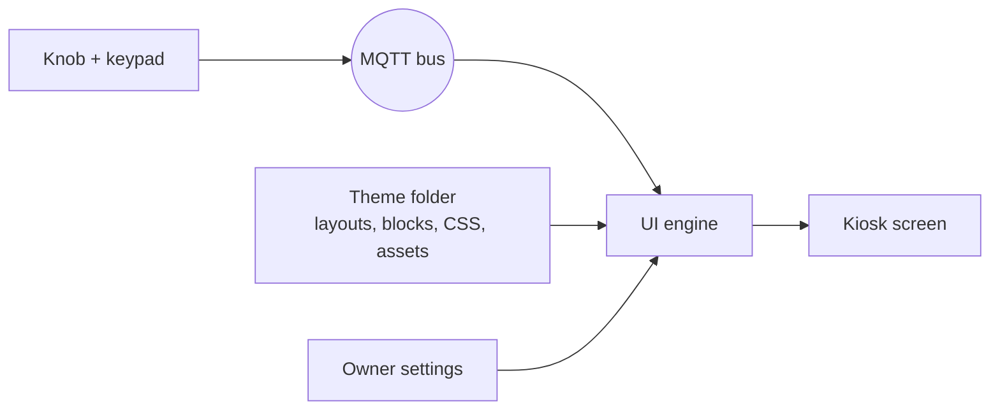

# JUKE.BOX Theme Format

Format version 1 · **Draft** · Oct 8, 2026

A theme decides how JUKE.BOX looks and how its screens are arranged. It is a folder of plain files: HTML layouts, CSS, images and fonts. A theme contains no code. The engine supplies all behavior: live data, the knob, keypad selection, screen changes and popups.

If you can write HTML and CSS, you can make a theme. Copy the default theme, change it, and drop it in the themes folder.

## Who decides what

Like WordPress, three parties shape what's on screen:

| Who | Decides | Example |
| --- | --- | --- |
| Engine | Behavior and data | What clicking a card does, which songs are "new" |
| Theme | Look and arrangement | A purple sidebar on the left, dark song cards |
| Owner (Settings) | What's switched on | Which Home sections show, which nav buttons show, songs per page, the active theme |

A theme provides **areas** (like WordPress widget areas and menus). The owner chooses what goes in them from Settings. A spartan setup and a busy one can use the same theme.

## How it fits together



- The **engine** loads the active theme, builds the screen from its layouts, fills every block with live data and moves the knob highlight.
- The **theme** says which blocks go where and what they look like.
- A theme never talks to the bus and never handles input.

## The theme folder

```
my-theme/
  theme.json          manifest (required)
  layouts/
    frame.json        the part of the screen that never changes (required)
    home.json         one layout per screen (home and all-songs required)
    all-songs.json
    settings.json
  blocks/             optional: your own markup for any block or popup
    song-card.html
  theme.css           your styles (required)
  assets/             images, icons, fonts, background video
  preview.png         shown in the theme picker
```

Themes live in two places:

- `/opt/juk3-box/themes/` for themes that ship with JUKE.BOX.
- `/var/lib/juk3-box/themes/` for themes you add. These survive updates.

## theme.json

```json
{
  "format": 1,
  "id": "neon-lounge",
  "name": "Neon Lounge",
  "version": "1.0.0",
  "author": "Your Name",
  "license": "GPL-3.0",
  "description": "Purple sidebar, dark song cards, neon tunnel.",
  "styles": ["theme.css"],
  "fonts": [
    { "family": "Oswald", "src": "assets/fonts/Oswald.woff2" }
  ],
  "background": { "type": "video", "src": "assets/tunnel.mp4" },
  "sizing": { "mode": "fluid" }
}
```

| Field | Required | Meaning |
| --- | --- | --- |
| `format` | yes | Theme format version. The engine refuses formats it doesn't know |
| `id` | yes | Folder-safe unique name, lowercase with hyphens |
| `name`, `version`, `author` | yes | Shown in the theme picker |
| `license`, `description` | no | Shown in the theme picker |
| `styles` | yes | CSS files, loaded in order |
| `fonts` | no | Font files to load |
| `background` | no | `image` or `video` behind everything; `none` for a plain color from your CSS |
| `sizing` | no | `fluid` (default) or `canvas`; see Fitting any screen |

## Layouts

A layout says which blocks go on a screen and how they're grouped. Layouts are JSON files in `layouts/`, not HTML, so the page builder can open, rearrange and save them. Your CSS decides how everything looks and where exactly it sits.

A layout is a tree of **containers** holding **blocks**:

```json
{
  "class": "home",
  "children": [
    { "block": "section", "type": "new", "limit": 2 },
    { "block": "section", "type": "browse", "focus": "home" },
    { "block": "section", "type": "recents", "limit": 6, "focus": "home" }
  ]
}
```

| Key | On | Meaning |
| --- | --- | --- |
| `children` | container | What's inside it, in order |
| `class` | container or block | A CSS class name, so your CSS can style it |
| `block` | block | Which block (see Blocks) |
| other keys | block | That block's settings, e.g. `type`, `limit`, `src` |
| `focus` | container or block | Makes its items knob stops in a focus group (see The knob) |

On the page, a container becomes a `<div>` with its class, and a block becomes its `<jb-…>` element: `{"block": "now-playing"}` becomes `<jb-now-playing>`. Style those in your CSS.

### frame.json

The frame is everything that stays put while screens change, such as a sidebar. It must contain exactly one `screen` block, where the current screen appears.

```json
{
  "class": "frame",
  "children": [
    { "class": "sidebar", "children": [
      { "block": "logo", "src": "assets/logo.png" },
      { "block": "nav", "focus": "nav", "focus-flow": "down-from-rest" },
      { "block": "now-playing" },
      { "block": "up-next", "limit": 5 }
    ]},
    { "class": "main", "children": [
      { "block": "screen" }
    ]}
  ]
}
```

### Owner changes and the page builder

The theme's layouts are its defaults. When the owner changes a layout, through Settings or the page builder, the engine saves the owner's version separately and uses it instead. The theme's files are never edited. "Reset to theme default" deletes the owner's version.

The simplest change needs no builder: a `sections` block holds whatever Home sections the owner switched on in Settings, in their chosen order.

```json
{ "block": "sections", "focus": "home" }
```

Text and images that are part of the look (headings, decorations) go in block markup and CSS, not in layouts. Block markup is HTML; `<script>` tags, inline event handlers (`onclick=` and friends) and links to outside websites are removed when the theme loads.

## Blocks

Blocks are what layouts place. The engine fills each one with live data. In a layout you write the name (`"block": "up-next"`); on the page it's the `<jb-…>` element (`<jb-up-next>`) you style.

| Block | Shows | Settings |
| --- | --- | --- |
| `screen` | Where the current screen goes (frame only) | |
| `logo` | The logo | `src` (falls back to the text JUKE.BOX) |
| `nav` | Navigation buttons the owner switched on | |
| `now-playing` | The current song | |
| `up-next` | The queue | `limit` |
| `board` | The song board | |
| `sections` | The owner's chosen Home sections | |
| `section` | One Home section, placed by the layout | `type`, `limit` |
| `page-info` | Board page and current sort, e.g. "Artists · Queen  1 of 2" | |
| `pager` | Knob stops for the board: Previous Page, Next Page, and (inside an artist, album or genre) a way back up to the full list | |

### Nav buttons

The engine knows these nav buttons. The owner picks which show, and in what order, in Settings.

| Button | Click |
| --- | --- |
| `home` | Go to Home |
| `all-songs` | Go to the song board |
| `settings` | Go to Settings |
| `volume` | Turn the knob to change the volume |
| `shuffle` | Shuffle on or off |

A theme gives each button its look with an icon file named after it (SVG, PNG or WebP): `assets/icons/home.svg`, `assets/icons/volume.svg` and so on. An optional `shuffle-on` icon replaces `shuffle` while shuffle is on. Labels come from the engine; while shuffle is on, its label reads "Singles", which is what a click switches to.

Each button sits in a `.jb-nav-item` element, which carries its states (see States you can style).

### Home sections

Each section is a row of cards. There are two kinds of card:

- **Song cards** pick the song when clicked, exactly like typing its code on the keypad: it plays now if nothing is playing, and otherwise joins the queue. Picks always go ahead of shuffle's own picks. (An owner setting, off by default, makes a click interrupt and play immediately.)
- **Link cards** open the song board sorted or filtered their way when clicked.

| Section | Cards | Click |
| --- | --- | --- |
| `new` | Songs added to the phone since the jukebox first synced it, newest first | Plays the song |
| `recents` | Songs played for at least 30 seconds, most recent first | Plays the song |
| `featured-artist` | An artist the engine picks at random, at startup and every 30 minutes | Opens the board filtered to that artist |
| `browse` | Shortcuts: Artist, Album, Genre, Top 100, Most Played, Recently Added and so on, chosen in Settings | Opens the board in that sort |

More section types will come with later format versions and plugins. A theme that doesn't style a new type gets the engine's plain look for it.

### Block markup

Every block has default markup. To change it, put a file in `blocks/`:

| File | Used for |
| --- | --- |
| `song-card.html` | Each song board slot |
| `up-next.html` | The Up Next frame (title, a place for its cards, a message when the queue is empty) |
| `queue-card.html` | Each Up Next item |
| `now-playing.html` | Now Playing |
| `nav-button.html` | Each nav button |
| `section.html` | A Home section's frame (title plus a place for its cards) |
| `song-tile.html` | Song cards in Home sections |
| `link-card.html` | Link cards in Home sections |
| `popup.html` | The frame of every popup |
| `popup-volume.html` | The volume popup's content |
| `popup-notice.html` | The content of short notices, such as "Connect your phone" |
| `page-info.html` | The board's page info: `sort`, `filter`, `page`, `pages` |
| `pager-button.html` | Each pager button: `label`, `icon` (from `assets/icons/page-prev`, `page-next`, `page-up`) |

A section can use its own card markup by type: `song-tile-new.html` overrides `song-tile.html` for the New section only.

Fill in data with attributes:

| Attribute | Does |
| --- | --- |
| `data-text="title"` | Sets the element's text |
| `data-src="cover"` | Sets an image's source |
| `data-if="artist"` | Shows the element only when that field has a value |
| `data-if-not="cover"` | Shows the element only when that field is empty |
| `data-slot="cards"` | Where the cards go (in `section.html`) |
| `data-slot="content"` | Where the content goes (in `popup.html`) |

```html
<!-- blocks/song-card.html -->
<div class="card">
  <span class="code" data-text="code"></span>
  
  <div class="cover placeholder" data-if-not="cover"></div>
  <div class="text">
    <div class="title" data-text="title"></div>
    <div class="artist" data-text="artist"></div>
  </div>
  <span class="length" data-text="length"></span>
</div>
```

### Data fields

A **track** (song cards, song tiles, queue, now playing):

| Field | Example | Notes |
| --- | --- | --- |
| `title` | Brown Sugar | Always present |
| `artist` | The Rolling Stones | May be empty |
| `album` | Sticky Fingers | May be empty |
| `year` | 1971 | May be empty |
| `length` | 3:49 | May be empty |
| `cover` | (image URL) | May be empty |
| `code` | A1 | Song board only |
| `position` | 1 | Queue only: place in line |

**Now playing** adds `elapsed` (e.g. 1:12) and `state` (`playing`, `paused`, `stopped`).

A **link card** has `label` (e.g. "Most Played"), `description` and `image`. Browse cards take their image from the theme: `assets/browse/most-played.jpg`, named after the sort. Featured artist cards use a cover from that artist.

A **section** has `title` (e.g. "New") and `count`, the number of cards in it. An empty section (nothing new yet, nothing played yet) has `data-empty`; hide it or show a message, your choice.

**Up Next** (`up-next.html`) has `count`, the number of songs queued: `data-if-not="count"` shows an element only when the queue is empty.

A **nav button** has `label` and `icon`.

A **popup** frame has `title`. The volume popup has `percent` (0 to 100); a notice has `message`.

**Every track field may be empty except `title`.** The phone only sends titles; the rest comes from online lookups that can miss. Design for a song with no cover and no artist.

### States you can style

The engine sets attributes; style them in your CSS.

| Where | Attribute | Meaning |
| --- | --- | --- |
| Any focusable item | `data-focused` | The knob highlight is here |
| Nav button (`.jb-nav-item`) | `data-active` | Its screen is showing |
| Nav button (`.jb-nav-item`) | `data-on` | Shuffle is on |
| Board slot | `data-empty` | No song in this slot |
| Board slot | `data-entry` | Its letter has been pressed, waiting for a digit |
| Now playing | `data-state` | `playing`, `paused` or `stopped` |
| Section | `data-type` | `new`, `recents`, `featured-artist`, `browse` |
| Section | `data-empty` | No cards (e.g. no new songs yet) |
| `<html>` | `data-screen` | Current screen name |
| `<html>` | `data-mode` | `select`, or a knob mode such as `volume` |
| `<html>` | `data-phone` | `connected` or `disconnected` |
| `<html>` | `data-popup` | Which popup is open, if any |

The engine also sets CSS variables you can use:

| Variable | Where | Value |
| --- | --- | --- |
| `--jb-progress` | Now playing | 0 to 1, song progress |
| `--jb-volume` | `<html>` | 0 to 1 |
| `--jb-digits` | Song board | Slots per letter, 1 to 10 |

A progress bar is then just CSS: `width: calc(var(--jb-progress) * 100%)`.

### The song board

The board shows one page of songs. Each slot has a code a guest types on the keypad: a letter, A to K (no I), then a digit, 1 to 9, then 0.

The owner sets the number of songs per page in Settings, from 10 to 100 in steps of 10. Each letter gets the same number of slots: 50 songs per page means A1 to A5 through K1 to K5. The codes always match the keypad.

The engine wraps each letter's slots in a group, so you can lay the board out by letter:

```html
<jb-board>
  <div class="jb-letter" data-letter="A">
    <div class="jb-slot" data-code="A1">…song card…</div>
    …
  </div>
  …
</jb-board>
```

How the slots are arranged on screen is up to your CSS. Use `--jb-digits` so the board fits whatever page size the owner picks.

In an artist, album or genre sort, the board first lists the artists (albums, genres) themselves, one per slot, with the name as the card's `title`; `<jb-board>` then has `data-category`. Picking one shows its songs.

Pressing a letter on the keypad brings up the All Songs screen if it isn't showing, so the guest sees what they're picking.

### Popups

Popups (volume, notices such as "connect your phone") open over everything. The engine supplies their content and behavior. A theme can restyle them like any block: `popup.html` for the frame every popup shares, and `popup-volume.html` for the volume popup's content.

## The knob

Turning the knob moves a highlight. Clicking acts on the highlighted item. The engine works out the order; the theme only gives hints.

- `"focus": "name"` in a layout marks a region whose items are knob stops: nav buttons, section cards, and so on.
- Within a group, items go in reading order: left to right, then top to bottom, by where they actually sit on screen. Rearranging a layout changes the order automatically.
- Groups follow each other in the order they appear in the frame and screen, content groups first.
- The engine makes the first item of the nav its resting item, normally Home. After a few seconds idle, the highlight returns there.
- `"focus-flow": "down-from-rest"` on the nav means a counter-clockwise turn from the resting item walks down the nav, and a clockwise turn goes into the screen's content.

The default theme's Home ring, clockwise: Home → every Home section card, in reading order → Settings → All Songs → Volume → Home.

The song board isn't a knob stop. Songs are picked with the keypad: letter, then digit.

## Fitting any screen

Themes must fit any monitor size and shape. There are two ways.

**Fluid (default, recommended).** Your CSS adapts to the screen.

- Size with `vw`, `vh`, `vmin`, `%`, `fr` and `clamp()`, not fixed pixel sizes for the whole screen.
- Use CSS grid or flexbox for layout.
- Test at least a wide (16:9 or 16:10) and a squarer (4:3) size. The theme preview tool will offer both.

**Canvas (easiest).** Design at one exact size in pixels, and the engine scales the whole screen evenly to fit. If the monitor's shape is different, the background fills the leftover space at the edges.

```json
"sizing": { "mode": "canvas", "width": 2000, "height": 1250 }
```

## Rules

- No code: scripts and event handlers are removed.
- Everything loads from the theme folder. Outside URLs are blocked, so a theme works offline and can't track anyone.
- The engine may add blocks, sections and fields in later format versions without breaking your theme. A breaking change bumps `format`.

## Not yet decided

- Favorites: a list the owner builds (e.g. a "favorite" option when clicking Now Playing), possibly seeded from the phone's own playlists. Becomes a section and a sort once it exists.
- Which settings appear on the cabinet's Settings screen and which only on the phone/laptop admin page (jb-admin).
- The page builder's own design (jb-admin, a later phase). Layouts are JSON now so it can be added without changing this format.
