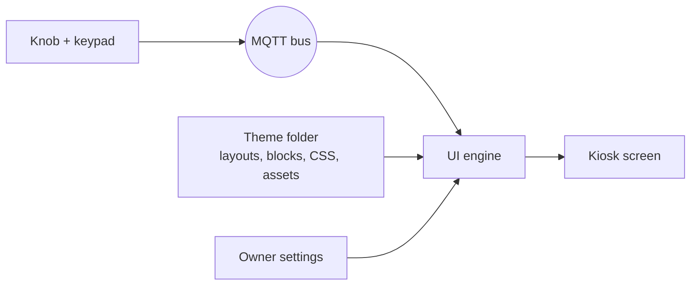

# JUKE.BOX Theme Format

Format version 1 · **Draft** · Oct 8, 2026

A theme decides how JUKE.BOX looks and how its screens are arranged. It is a folder of plain files: HTML layouts, CSS, images and fonts. A theme contains no code. The engine supplies all behavior: live data, the knob, keypad selection, screen changes and popups.

If you can write HTML and CSS, you can make a theme. Copy the default theme, change it, and drop it in the themes folder.

## Who decides what

Like WordPress, three parties shape what's on screen:

| Who | Decides | Example |
| --- | --- | --- |
| Engine | Behavior and data | What clicking a card does, which songs are "new" |
| Theme | Look and arrangement | A purple sidebar on the left, dark song cards |
| Owner (Settings, page builder) | What's switched on, and each module's settings | Which nav buttons show, songs per page, the active theme; each Home module's settings (which Browse categories, how many cards, See All on or off, shown or hidden) |

A theme provides **areas** (like WordPress widget areas and menus). The owner chooses what goes in them from Settings. A spartan setup and a busy one can use the same theme.

## How it fits together



- The **engine** loads the active theme, builds the screen from its layouts, fills every block with live data and moves the knob highlight.
- The **theme** says which blocks go where and what they look like.
- A theme never talks to the bus and never handles input.

## The theme folder

```
my-theme/
  theme.json          manifest (required)
  layouts/
    frame.json        the part of the screen that never changes (required)
    home.json         one layout per screen (home and all-songs required)
    all-songs.json
    settings.json
    collection.json   optional: the See All view
  blocks/             optional: your own markup for any block or popup
    song-card.html
  theme.css           your styles (required)
  assets/             images, icons, fonts, background video
  preview.png         shown in the theme picker
```

Themes live in two places:

- `/opt/juk3-box/themes/` for themes that ship with JUKE.BOX.
- `/var/lib/juk3-box/themes/` for themes you add. These survive updates.

## theme.json

```json
{
  "format": 1,
  "id": "neon-lounge",
  "name": "Neon Lounge",
  "version": "1.0.0",
  "author": "Your Name",
  "license": "GPL-3.0",
  "description": "Purple sidebar, dark song cards, neon tunnel.",
  "styles": ["theme.css"],
  "fonts": [
    { "family": "Oswald", "src": "assets/fonts/Oswald.woff2" }
  ],
  "background": { "type": "video", "src": "assets/tunnel.mp4" },
  "sizing": { "mode": "fluid" }
}
```

| Field | Required | Meaning |
| --- | --- | --- |
| `format` | yes | Theme format version. The engine refuses formats it doesn't know |
| `id` | yes | Folder-safe unique name, lowercase with hyphens |
| `name`, `version`, `author` | yes | Shown in the theme picker |
| `license`, `description` | no | Shown in the theme picker |
| `styles` | yes | CSS files, loaded in order |
| `fonts` | no | Font files to load. A variable font can give its ranges, e.g. `"weight": "1 1000", "stretch": "25% 151%"`, so bold and condensed use its real axes |
| `icons` | no | Library icons for the engine's buttons, e.g. `{"home": "lucide:house"}` (see Icons) |
| `background` | no | `image` or `video` behind everything; `none` for a plain color from your CSS. Ship a video at any size, frame rate or format: JUKE.BOX re-encodes it once for the hardware (H.264, at most 1280x720, 30 fps) and plays that copy; your file is never changed |
| `sizing` | no | `fluid` (default) or `canvas`; see Fitting any screen |
| `customize` | no | The options an owner can change from the admin's Appearance page, and your preset styles; see Customize |

### Customize

The global look an owner can change without touching your files: colors, font, shape, background. You declare the options and a few preset **styles** (options that go together); the admin draws the form from them, and the owner picks a style and changes any option on top of it.

```json
"customize": {
  "options": [
    { "id": "panel", "label": "Panels", "group": "colors", "type": "color", "default": "#0d1428", "help": "The sidebar and cards." },
    { "id": "cover-colors", "label": "Use cover colors", "group": "colors", "type": "toggle", "default": true },
    { "id": "font", "label": "Font", "group": "fonts", "type": "font", "default": "theme", "family": "\"Oswald\", sans-serif" },
    { "id": "roundness", "label": "Corner roundness", "group": "shape", "type": "range", "min": 0, "max": 2, "step": 0.1, "default": 1 },
    { "id": "background", "label": "Background picture", "group": "background", "type": "picture", "role": "background", "default": "" }
  ],
  "styles": [
    { "id": "midnight", "label": "Midnight", "description": "The original.", "values": {} },
    { "id": "sunset", "label": "Sunset", "values": { "panel": "#22102a" } }
  ]
}
```

The engine sets every option on the page as `--opt-<id>` before your CSS loads, so your CSS reads `var(--opt-panel)`:

| Type | Value | `--opt-<id>` |
| --- | --- | --- |
| `color` | `#rrggbb` | the color. For shades of it use `hsl(from var(--opt-panel) h s calc(l + 8) / 0.8)`: a whole family of shades follows the one option (scale saturation, `calc(s * 0.9)`, rather than adding to it, so a grey choice stays grey) |
| `range` | a number from `min` to `max` | the number, e.g. `calc(1.7vh * var(--opt-roundness))` |
| `toggle` | true / false | `1` / `0`; also `<html data-opt-<id>="on|off">` for selectors |
| `font` | `theme` or a font from the engine's library (Inter, Oswald, Bebas Neue, Righteous, Nunito, Courier Prime, Playfair Display) | a `font-family` value; `theme` gives the option's `family` |
| `picture` | `""` (your default), a file in your theme, or an owner upload (`/media/<file>`) | `url(...)`. With `"role": "background"` it replaces the theme's background; add `"video": true` and it may be a video too (an owner upload, always converted to MP4 for the Pi, or one in your theme, which jb-ui converts) |

Groups (`colors`, `fonts`, `shape`, `background`, `motion`) set where an option shows in the admin. The first style is the default, so make it your theme as designed with `"values": {}`. An owner's value that's no longer usable (an option you removed, a color in the wrong form) is ignored, with a warning in the log, and the style's value used.

## Layouts

A layout says which blocks go on a screen and how they're grouped. Layouts are JSON files in `layouts/`, not HTML, so the page builder can open, rearrange and save them. Your CSS decides how everything looks and where exactly it sits.

A layout is a tree of **containers** holding **blocks**:

```json
{
  "class": "home",
  "children": [
    { "class": "home-sections", "focus": "home", "children": [
      { "block": "section", "type": "new", "limit": 2 },
      { "block": "section", "type": "browse", "sorts": "artist,album,top-100,most-played" },
      { "block": "section", "type": "recents", "limit": 18 }
    ]}
  ]
}
```

| Key | On | Meaning |
| --- | --- | --- |
| `children` | container | What's inside it, in order |
| `class` | container or block | A CSS class name, so your CSS can style it |
| `block` | block | Which block (see Blocks) |
| other keys | block | That block's settings, e.g. `type`, `limit`, `src` |
| `focus` | container or block | Makes its items knob stops in a focus group (see The knob) |

On the page, a container becomes a `<div>` with its class, and a block becomes its `<jb-…>` element: `{"block": "now-playing"}` becomes `<jb-now-playing>`. Style those in your CSS.

### frame.json

The frame is everything that stays put while screens change, such as a sidebar. It must contain exactly one `screen` block, where the current screen appears.

```json
{
  "class": "frame",
  "children": [
    { "class": "sidebar", "children": [
      { "block": "logo", "src": "assets/logo.png" },
      { "block": "nav", "focus": "nav", "focus-flow": "down-from-rest" },
      { "block": "now-playing" },
      { "block": "up-next", "limit": 5 }
    ]},
    { "class": "main", "children": [
      { "block": "screen" }
    ]}
  ]
}
```

### Owner changes and the page builder

The theme's layouts are its defaults. When the owner changes a layout, through Settings or the page builder, the engine saves the owner's version separately and uses it instead. The theme's files are never edited. "Reset to theme default" deletes the owner's version.

The page builder (jb-admin, from a phone or computer) edits a draft, which only its preview shows; Publish puts it on the cabinet, which reloads. Owner versions are kept per theme, in `/var/lib/juk3-box/layouts/<theme>/`, and every published version is kept as a revision (the last 20). An owner layout is checked exactly like a theme's; one that fails is ignored and your layout is shown instead. See [docs/contracts/configuration.md](contracts/configuration.md).

The builder's preview runs the real engine with `?preview`: it publishes nothing to the jukebox, and it tags every element with `data-jb-path` (its place in the layout) so a click can select it. Neither happens on the cabinet; don't style `data-jb-path`.

Blocks are modules, the way a page builder's are: each carries its own settings in the layout (a Home row's categories, card count, See All). The owner's Settings toggles and the page builder both edit those same settings in the owner's copy of the layout. There is no separate list of what's switched on.

Text and images that are part of the look (headings, decorations) go in block markup and CSS, not in layouts. Block markup is HTML; `<script>` tags, inline event handlers (`onclick=` and friends) and links to outside websites are removed when the theme loads.

## Blocks

Blocks are what layouts place. The engine fills each one with live data. In a layout you write the name (`"block": "up-next"`); on the page it's the `<jb-…>` element (`<jb-up-next>`) you style.

| Block | Shows | Settings |
| --- | --- | --- |
| `screen` | Where the current screen goes (frame only) | |
| `logo` | The logo | `src` (falls back to the text JUKE.BOX) |
| `nav` | Navigation buttons the owner switched on | |
| `now-playing` | The current song | |
| `up-next` | The queue | `limit` |
| `board` | The song board | |
| `section` | One Home row of cards (see Home sections) | `type`, `limit`, `title`, `sorts`, `see-all`, `show` |
| `page-info` | Board page and current sort, e.g. "Artists · Queen  1 of 2" | |
| `pager` | Knob stops for the board: Previous Page and Next Page | |
| `header` | The screen's title and subtitle ("Browse by Genre" / "Classic Rock", or "All Songs" / "Page 1 of 10") and a Back button. Back leaves an artist (album, genre) for the list of them, else returns to the previous screen | |
| `connection` | The phone badge: connected or not, and the phone's name. A knob stop; clicking it will manage phones once the phone connection manager exists (for now it shows who's connected) | |
| `collection` | A section's See All view: all its cards in a grid (every Browse option, the last 100 played, every new song) | |
| `heading` | A title the owner writes | `text`, `size` (`small`, `medium`, `large`), `align` (`start`, `center`, `end`) |
| `text` | A paragraph the owner writes (line breaks kept) | `text`, `align` |
| `image` | A picture from the owner's media library or the theme | `src`, `alt`, `width` (`small`, `medium`, `large`, `full`), `align`, `fit` (`contain`, `cover`) |
| `spacer` | Empty space | `size` (`small`, `medium`, `large`) |
| `shortcut` | One card that opens a genre, artist, album, playlist or list; several share a row | `opens` (`genre`, `artist`, `album`, `playlist`, `list`), `which`, `list` (`title`, `artist`, `album`, `genre`, `playlist`, `top-100`, `most-played`), `label`, `picture-from` (`cover`: a cover from what it opens, changing every half hour; `picture`), `picture`, `tint` (a color; also `--jb-tint`), `tint-strength`, `icon`. Markup: `shortcut.html`, classes `.jb-shortcut-*`, inside a `.jb-card` |

The last four are owner content: what the page builder offers for words and pictures of the owner's own. The engine gives them a plain look (`jb-heading > h2`, `jb-text > p`, `jb-image > img`) that suits a dark theme; style them in your CSS like any block. Each takes a full line inside a flex container, like a paragraph.

A picture setting (`image` and `logo` `src`) is either a file in the theme (`assets/logo.png`) or one the owner uploaded to the media library, written with a leading slash: `/media/photo.jpg`.

Every block, its settings and their allowed values are also published as data, for tools: `services/jb_ui/block_schema.json`.

### Layout helpers

Containers the owner adds in the page builder can't count on your CSS knowing them, so the engine has a few classes that work under any theme. Use them in your own layouts too, or restyle them.

| Class | Does |
| --- | --- |
| `jb-u-row` | Children side by side, sharing the width, wrapping when needed |
| `jb-u-column` | Children stacked |
| `jb-u-grid-2`, `jb-u-grid-3`, `jb-u-grid-4` | A grid, that many across |
| `jb-u-gap-none`, `jb-u-gap-small`, `jb-u-gap-large` | Space between children (`--jb-u-gap`) |
| `jb-u-pad-small`, `jb-u-pad-medium`, `jb-u-pad-large` | Space inside |
| `jb-u-grow` | Fill the leftover space |
| `jb-u-scroll` | Scroll when the content is taller than the space |
| `jb-u-center` | Center the content |

Inside one of your own flex containers, a row, column or grid takes a full line.

### Widths

Any block or container directly inside a `jb-u-row` or grid can have a `span` setting (the page builder's **Width**): `full`, `1-2`, `1-3`, `2-3`, `1-4` or `3-4`. In a row it takes that share of the width less its share of the gaps, so `1-3` + `2-3`, or three `1-3`s, fill a line exactly; blocks without a span share what's left. Shares adding up to more than a line wrap. In a grid, `full` spans the whole line and the larger shares span columns where the grid divides that way (`2-3` in `jb-u-grid-3`; `1-2`, `3-4` in `jb-u-grid-4`).

### Shapes

Some blocks fit themselves to the space they're given. The engine measures the block's width (as a share of the screen's height, so it holds at any resolution) and sets `data-shape` on its element; the owner can fix one instead with the block's `shape` setting (**Layout** in the page builder).

| Block | Shapes, narrowest first |
| --- | --- |
| `now-playing` | `compact` (under 0.42 × screen height): your sidebar design. `card` (from 0.42): cover left, words right. `banner` (from 0.95): words left, cover right, a background and the owner's tagline |
| `up-next` | `compact`: your sidebar list. `strip` (from 0.6): a row of song cards, as many as fit |
| `nav` | `compact`: your stacked buttons. `bar` (from 0.6): side by side |
| `section` | `narrow`, `medium` (from 0.7), `wide` (from 1.15): your design. Narrow and medium show fewer cards across (`--jb-section-across`), and only inside the page builder's rows, columns and grids; in your own containers your design stands |

The shape a block was designed for (the sidebar's, or a card row's full width) is your theme's own design and gets nothing from the engine. For the wider ones the engine has working defaults in `engine.css`; restyle them with the same selectors, e.g. `jb-now-playing[data-shape="banner"] .jb-np-card { ... }`. Now Playing's template has two elements only those shapes show: `.jb-np-backdrop` (the blurred cover, or the owner's picture, with `data-kind` = `cover`, `picture` or `none`) and `.jb-np-tagline`.

### Nav buttons

The engine knows these nav buttons. The owner picks which show, and in what order, in Settings.

| Button | Click |
| --- | --- |
| `home` | Go to Home |
| `all-songs` | Go to the song board |
| `settings` | Go to Settings |
| `volume` | Turn the knob to change the volume |
| `now-playing` | Opens the Now Playing overlay |
| `shuffle` | Shuffle on or off |

The default order is Home, Volume, Shuffle, All Songs, Settings. `now-playing` can be added as a nav button, but by default Now Playing is the header of the `now-playing` block (its `data-stop="open"`), which opens the overlay; put the block in the same focus group as the nav to keep the knob walking from Settings into it. Labels come from the engine; while shuffle is on, its label reads "Single Play", which is what a click switches to. Icons: see Icons.

Each button sits in a `.jb-nav-item` element, which carries its states (see States you can style).

### Home sections

Each section is a row of cards. There are two kinds of card:

- **Song cards** pick the song when clicked, exactly like typing its code on the keypad: it plays now if nothing is playing, and otherwise joins the queue. Picks always go ahead of shuffle's own picks. (An owner setting, off by default, makes a click interrupt and play immediately.)
- **Link cards** open the song board sorted or filtered their way when clicked.

| Section | Cards | Click |
| --- | --- | --- |
| `new` | Songs added to the phone since the jukebox first synced it, newest first | Plays the song |
| `recents` | Songs played for at least 30 seconds, most recent first | Plays the song |
| `featured-artist` | **Featured** in the admin: one artist, album, genre or playlist. Settings: `feature` (artist, album, genre, playlist), `from` (any, most-played, recently-added, recently-played, pinned, with `pin` naming it), `every` (minutes between changes, 0 = never), `repeats`. The pick is kept in the browser, so a reload doesn't change it; several Featured blocks never show the same thing at once. Cards get `kicker`, the heading ("Most Played Album") | Opens the board filtered to it |
| `playlists` | The phone's own playlists (from the deep crawl), with a cover from their songs. Empty playlists are left out | Opens the board on that playlist's songs, in its order |
| `browse` | Shortcuts to sorts: `title`, `artist`, `album`, `genre`, `playlist`, `top-100`, `most-played` | Opens the board in that sort |

A section's settings:

| Setting | Meaning | Default |
| --- | --- | --- |
| `type` | Which section (above) | required |
| `limit` | How many cards | New 2, Featured Artist 1, Browse all its sorts, Playlists 12, Recents 18 |
| `title` | Its heading | New, Featured Artist, Browse, Playlists, Recents |
| `sorts` | Browse only: which categories, comma-separated, e.g. `"artist,genre,top-100"` | `artist,album,top-100,most-played` |
| `see-all` | Show See All in its header | `true` (New, Browse, Playlists, Recents) |
| `show` | `false` hides the row | `true` |

See All (`data-stop="see-all"` in `section.html`) opens the `collection` screen, the section's full page, like a WordPress archive: every Browse category, the last 100 played, or every new song, as cards. A theme lays that screen out in `layouts/collection.json`; without one, the engine uses a header plus the cards.

The Home sections area should scroll (`overflow-y: auto`): when the knob moves to a card below the fold, the engine scrolls it smoothly into view, and back to the top when the highlight returns to rest.

More section types will come with later format versions and plugins. A theme that doesn't style a new type gets the engine's plain look for it.

### Icons

JUKE.BOX bundles open-source icon sets in [Iconify](https://iconify.design)'s format, starting with [Lucide](https://lucide.dev) (ISC license). They live on the jukebox, so they work offline. More sets can be added as files (and later downloaded from jb-admin).

Every button the engine draws has an icon name: `home`, `volume`, `all-songs`, `settings`, `now-playing`, `shuffle`, `shuffle-on` (while shuffle is on), `back`, `page-prev`, `page-next`, `see-all`, `card-open`, `play`, `favorite`, `close`, `connection`, `dropdown`. For each, the engine uses the first of:

1. A file in your theme: `assets/icons/<name>.svg` (or PNG, WebP).
2. Your choice in theme.json: `"icons": {"home": "lucide:house"}`. Any icon in a bundled set, as `set:name`.
3. The engine's default.

`jb:eq` is an icon the engine draws itself: equalizer bars (`<span class="jb-eq"><i></i>...</span>`) for you to animate while `<html data-playing>`. It's the default for `now-playing`.

Library icons are inline SVG drawn in `currentColor`, so `color` and `font-size` style them.

### Art colors

The engine samples every picture a template shows through `data-src` and sets three CSS variables on the closest element with `data-art-scope` (else the image's parent):

| Variable | Is |
| --- | --- |
| `--jb-art-1` | The picture's most vivid color |
| `--jb-art-2` | A second vivid color, different in hue (or a lighter first color) |
| `--jb-art-dark` | Its edges' average color, darkened |
| `--jb-art-main` | Its dominant color (the hue covering most of it), at a mid-light tone: a surface that takes the cover's color, light or dark |

Use them for glows, gradient edges and vignettes that match whatever art a card shows, with a fallback for while it loads: `var(--jb-art-1, #4f6dff)`. Cards, board slots, the Now Playing block and Up Next items are scopes already.

### Block markup

Every block has default markup. To change it, put a file in `blocks/`:

| File | Used for |
| --- | --- |
| `song-card.html` | Each song board slot |
| `up-next.html` | The Up Next frame (title, a place for its cards, a message when the queue is empty) |
| `queue-card.html` | Each Up Next item |
| `now-playing.html` | Now Playing |
| `nav-button.html` | Each nav button |
| `section.html` | A Home section's frame (title plus a place for its cards) |
| `song-tile.html` | Song cards in Home sections |
| `link-card.html` | Link cards in Home sections |
| `popup.html` | The frame of every popup |
| `popup-volume.html` | The volume popup's content |
| `popup-notice.html` | The content of short notices, such as "Connect your phone" |
| `popup-now-playing.html` | The Now Playing overlay: `song`, `artist`, `album`, `year`, `cover`, `elapsed`, `length`, `favorite`, `favoriteLabel`, and stops `favorite` and `close` |
| `popup-phones.html` | The phone badge's popup: `name`, `status` |
| `popup-power.html` | The power menu (hold Reset 4 s, or 1 s with nothing playing): `message`, `countdown`, and stops `reboot`, `shutdown` and `cancel`. The knob starts on `cancel` |
| `header.html` | The screen header: `title`, `subtitle`, `canGoBack`, and the stop `back` |
| `connection.html` | The phone badge: `status`, `name`, `icon`, `moreIcon` |
| `page-info.html` | The board's page info: `sort`, `filter`, `page`, `pages` |
| `pager-button.html` | Each pager button: `label`, `icon` (from `assets/icons/page-prev`, `page-next`, `page-up`) |

A section can use its own card markup by type: `song-tile-new.html` overrides `song-tile.html` for the New section only.

Fill in data with attributes:

| Attribute | Does |
| --- | --- |
| `data-text="title"` | Sets the element's text |
| `data-src="cover"` | Sets an image's source |
| `data-if="artist"` | Shows the element only when that field has a value |
| `data-if-not="cover"` | Shows the element only when that field is empty |
| `data-slot="cards"` | Where the cards go (in `section.html`) |
| `data-slot="content"` | Where the content goes (in `popup.html`) |
| `data-icon="icon"` | Puts that field's icon inside the element |
| `data-stop="name"` | Makes the element a knob stop the engine knows by that name (e.g. `see-all` in `section.html`, `favorite` in the overlay) |
| `data-art-scope` | Where that card's art colors are set (see Art colors) |

```html
<!-- blocks/song-card.html -->
<div class="card">
  <span class="code" data-text="code"></span>
  
  <div class="cover placeholder" data-if-not="cover"></div>
  <div class="text">
    <div class="title" data-text="title"></div>
    <div class="artist" data-text="artist"></div>
  </div>
  <span class="length" data-text="length"></span>
</div>
```

### Data fields

A **track** (song cards, song tiles, queue, now playing):

| Field | Example | Notes |
| --- | --- | --- |
| `title` | Brown Sugar | Always present |
| `artist` | The Rolling Stones | May be empty |
| `album` | Sticky Fingers | May be empty |
| `year` | 1971 | May be empty |
| `length` | 3:49 | May be empty |
| `cover` | (image URL) | May be empty |
| `code` | A1 | Song board only |
| `position` | 1 | Queue only: place in line |
| `backdrop` | (image URL) | Home song and feature cards: a tiny (24px) copy of the art. Stretched, it looks blurred with no filter: use it for soft backgrounds |

**Now playing** adds `elapsed` (e.g. 1:12) and `state` (`playing`, `paused`, `stopped`).

A **link card** has `label` (e.g. "Most Played"), `description` and `image`. Browse cards take their image from the theme, named after the sort: `assets/browse/most-played.jpg` (JPG, PNG or WebP). Without one, the card shows a random cover from that sort's own songs, changing every 30 minutes. Featured artist cards use a cover from that artist.

A **section** has `title` (e.g. "New") and `count`, the number of cards in it. An empty section (nothing new yet, nothing played yet) has `data-empty`; hide it or show a message, your choice.

**Up Next** (`up-next.html`) has `count`, the number of songs queued: `data-if-not="count"` shows an element only when the queue is empty.

A **nav button** has `label` and `icon`.

A **popup** frame has `title`. The volume popup has `percent` (0 to 100); a notice has `message`.

**Every track field may be empty except `title`.** The phone only sends titles; the rest comes from online lookups that can miss. Design for a song with no cover and no artist.

### States you can style

The engine sets attributes; style them in your CSS.

| Where | Attribute | Meaning |
| --- | --- | --- |
| Any focusable item | `data-focused` | The knob highlight is here |
| Any focusable item | `data-pressed` | Just clicked (for about 0.2s), for a press effect |
| Nav button (`.jb-nav-item`) | `data-active` | Its screen is showing |
| Nav button (`.jb-nav-item`) | `data-on` | Shuffle is on |
| Board slot | `data-empty` | No song in this slot |
| Board slot | `data-entry` | Its letter has been pressed, waiting for a digit |
| Now playing | `data-state` | `playing`, `paused` or `stopped` |
| Section | `data-type` | `new`, `recents`, `featured-artist`, `browse`, `playlists` |
| Section | `data-empty` | No cards (e.g. no new songs yet) |
| `<html>` | `data-screen` | Current screen name |
| `<html>` | `data-mode` | `select`, or a knob mode such as `volume` |
| `<html>` | `data-phone` | `connected` or `disconnected` |
| `<html>` | `data-popup` | Which popup is open, if any |
| `<html>` | `data-playing` | A song is playing (e.g. to animate `.jb-eq`) |
| Popup frame | `data-modal` | The popup holds knob stops; the knob stays inside it |

The engine also sets CSS variables you can use:

| Variable | Where | Value |
| --- | --- | --- |
| `--jb-progress` | Now playing | 0 to 1, song progress |
| `--jb-volume` | `<html>` | 0 to 1 |
| `--jb-digits` | Song board | Slots per letter, 1 to 10 |

A progress bar is then just CSS: `width: calc(var(--jb-progress) * 100%)`.

### The song board

The board shows one page of songs. Each slot has a code a guest types on the keypad: a letter, A to K (no I), then a digit, 1 to 9, then 0.

The owner sets the number of songs per page in Settings, from 10 to 100 in steps of 10. Each letter gets the same number of slots: 50 songs per page means A1 to A5 through K1 to K5. The codes always match the keypad.

The engine wraps each letter's slots in a group, so you can lay the board out by letter:

```html
<jb-board>
  <div class="jb-letter" data-letter="A">
    <div class="jb-slot" data-code="A1">…song card…</div>
    …
  </div>
  …
</jb-board>
```

How the slots are arranged on screen is up to your CSS. Use `--jb-digits` so the board fits whatever page size the owner picks.

In an artist, album, genre or playlist sort, the board first lists the artists (albums, genres, playlists) themselves, one per slot, with the name as the card's `title`; `<jb-board>` then has `data-category`. Picking one shows its songs.

Pressing a letter on the keypad brings up the All Songs screen if it isn't showing, so the guest sees what they're picking.

### Popups

Popups (volume, notices such as "connect your phone", the phone badge, the Now Playing overlay) open over everything. The engine supplies their content and behavior. A theme can restyle them like any block: `popup.html` for the frame every popup shares, and `popup-<name>.html` for each one's content. The Now Playing overlay holds knob stops (Favorite, Close); while it's open the knob stays inside it.

## The knob

Turning the knob moves a highlight. Clicking acts on the highlighted item. The engine works out the order; the theme only gives hints.

- `"focus": "name"` in a layout marks a region whose items are knob stops: nav buttons, section cards, and so on.
- Within a group, items go in reading order: left to right, then top to bottom, by where they actually sit on screen. Rearranging a layout changes the order automatically.
- Groups follow each other in the order they appear in the frame and screen, content groups first.
- The engine makes the first item of the nav its resting item, normally Home. After a few seconds idle, the highlight returns there.
- `"focus-flow": "down-from-rest"` on the nav means a counter-clockwise turn from the resting item walks down the nav, and a clockwise turn goes into the screen's content.

The default theme's Home ring, clockwise: Home → every Home section card, in reading order → Settings → All Songs → Volume → Home.

The song board isn't a knob stop. Songs are picked with the keypad: letter, then digit.

## Fitting any screen

Themes must fit any monitor size and shape. There are two ways.

**Fluid (default, recommended).** Your CSS adapts to the screen.

- Size with `vw`, `vh`, `vmin`, `%`, `fr` and `clamp()`, not fixed pixel sizes for the whole screen.
- Use CSS grid or flexbox for layout.
- Test at least a wide (16:9 or 16:10) and a squarer (4:3) size. The theme preview tool will offer both.

**Canvas (easiest).** Design at one exact size in pixels, and the engine scales the whole screen evenly to fit. If the monitor's shape is different, the background fills the leftover space at the edges.

```json
"sizing": { "mode": "canvas", "width": 2000, "height": 1250 }
```

## Performance

JUKE.BOX runs on a Raspberry Pi with a video playing behind your theme. Measured there:

- Animate only `transform` and `opacity`. Animating `box-shadow`, `background` or `filter` repaints every frame; on focus changes it kept the page busy 70% of the time. For a focus look that changes a shadow or glow, pre-draw it on a `::before`/`::after` layer and fade that layer's opacity, and give the layer `will-change: opacity` so the fade happens on the GPU (without it, fading a layer on a big card still repainted the card and dropped 25% of the video's frames).
- No `backdrop-filter` over the video: it's recomputed every frame and halved the frame rate.
- No `filter: blur()` on anything that moves or scales (a focused card): the blur is redone every frame and the video stalls. For a blurred picture, use the `backdrop` field.
- Static effects are cheap: rounded corners, masked gradient rims, box-shadows that don't animate, gradients.
- Keep `will-change: transform` on elements that scale when focused.

## Rules

- No code: scripts and event handlers are removed.
- Everything loads from the theme folder. Outside URLs are blocked, so a theme works offline and can't track anyone.
- The engine may add blocks, sections and fields in later format versions without breaking your theme. A breaking change bumps `format`.

## Not yet decided

- Favorites: a list the owner builds (e.g. a "favorite" option when clicking Now Playing), possibly seeded from the phone's own playlists. Becomes a section and a sort once it exists.
- Which settings appear on the cabinet's Settings screen and which only on the phone/laptop admin page (jb-admin).
- Pages of the owner's own (beyond the engine's screens), reachable from the nav. The page builder edits the engine's screens and the frame for now.
